# Лабораторная работа №4. Облачные хранилища. Amazon S3

**Студентка:** Scripnic Xenia  
**Группа:** IA2404  
**Специальность:** Прикладная информатика  
**Выбранный уровень:**
**Регион AWS:** Europe (Frankfurt), `eu-central-1`  


## Цель работы

Изучить работу с объектным хранилищем Amazon S3: создание приватного бакета и объектов через веб-консоль и AWS CLI; просмотр метаданных; применение политики безопасности для обязательного HTTPS; версионирование и восстановление файлов; настройка жизненного цикла; выдача и проверка временных подписанных URL.

## Средства и исходные данные

- AWS Management Console, Amazon S3 и AWS CLI `2.38.1` в Windows PowerShell 5.1.
- Бакет: `timecapsule-dev-uploads-ksenia`; тип General purpose, `ACLs disabled`, `Block all public access`, шифрование SSE-S3.
- Теги бакета: `Name=timecapsule-dev-uploads-ksenia`, `Project=timecapsule`, `Environment=dev`, `Owner=ksenia`, `Lab=lab4`.
- CloudShell был недоступен из-за проверки аккаунта; поэтому разрешённые условием команды CLI выполнены локально в PowerShell. После повторной авторизации команда `aws sts get-caller-identity` сработала.
- Продвинутая часть (задания 7–14), перенос приложения, роли IAM и серверы из ЛР3 в этой работе не выполнялись.

## Ход выполнения работы

### Задание 1. Бакет и объекты в консоли

Создан бакет `timecapsule-dev-uploads-ksenia` в `eu-central-1` с отключёнными ACL и блокировкой публичного доступа; до задания 4 версионирование было выключено. Созданы префиксы `uploads/` и `backups/`: в `uploads/` помещены PNG и PDF, в `backups/` — `backup.txt` с текстом тестового резервного файла.

| Проверенный параметр изображения | Фактическое значение |
|---|---|
| Ключ (Key) | `uploads/f3f2f816e6c13a7f9aa671dc2c4c13e4.png` |
| Content-Type | `image/png` |
| ETag | `83b9c10da471ff1e1c8fb5bbd40cb362` |
| Object URL | `https://timecapsule-dev-uploads-ksenia.s3.eu-central-1.amazonaws.com/uploads/f3f2f816e6c13a7f9aa671dc2c4c13e4.png` |
| Размер (S3 CLI head-object) | 218824 байта |
| Результат открытия прямого URL | `AccessDenied` |

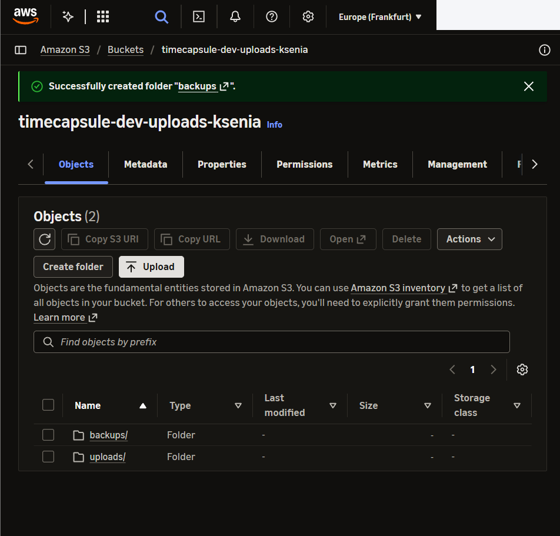

*Рисунок 01. Создан бакет S3; в корне находятся папки uploads/ и backups/.*

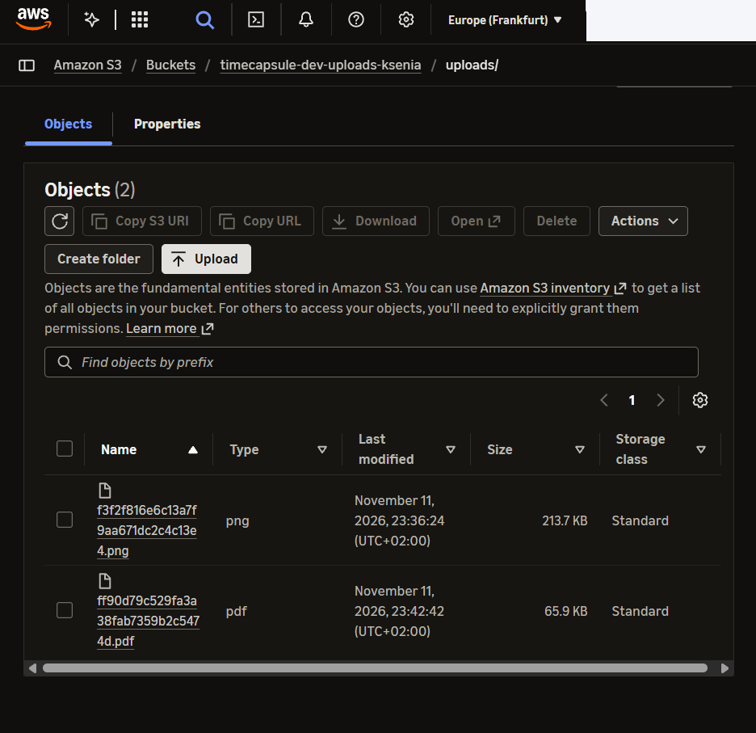

*Рисунок 02. В папку uploads/ через консоль загружены PNG и PDF.*

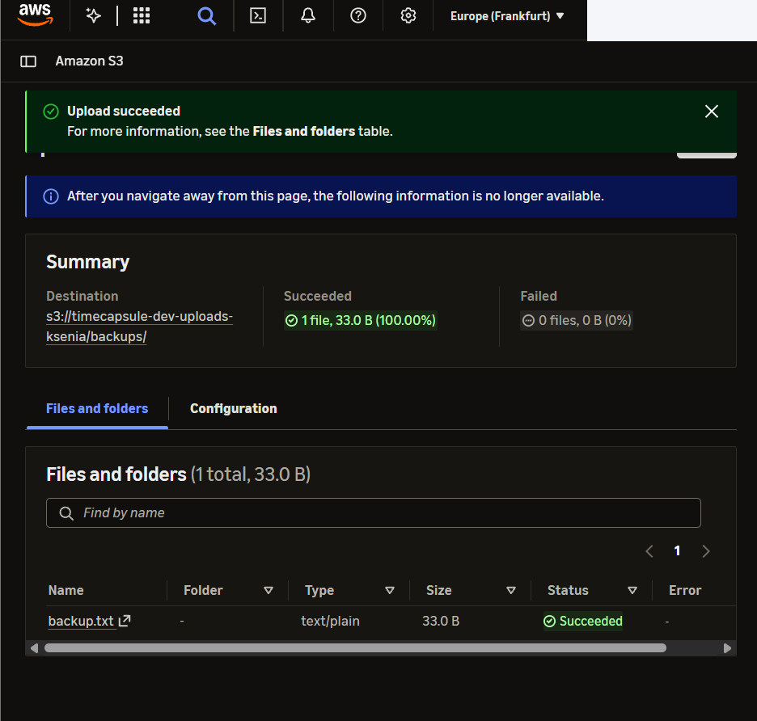

*Рисунок 03. Файл backup.txt успешно загружен в backups/ (text/plain, 33 B).*

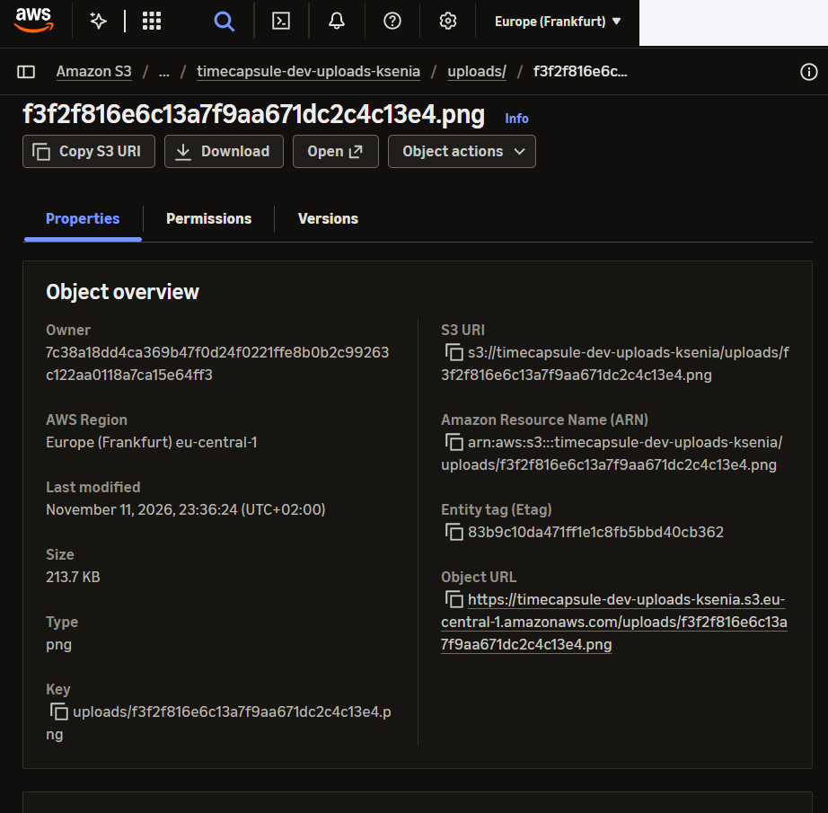

*Рисунок 04. Свойства PNG: S3 URI, ключ, ETag, Object URL, размер и регион.*

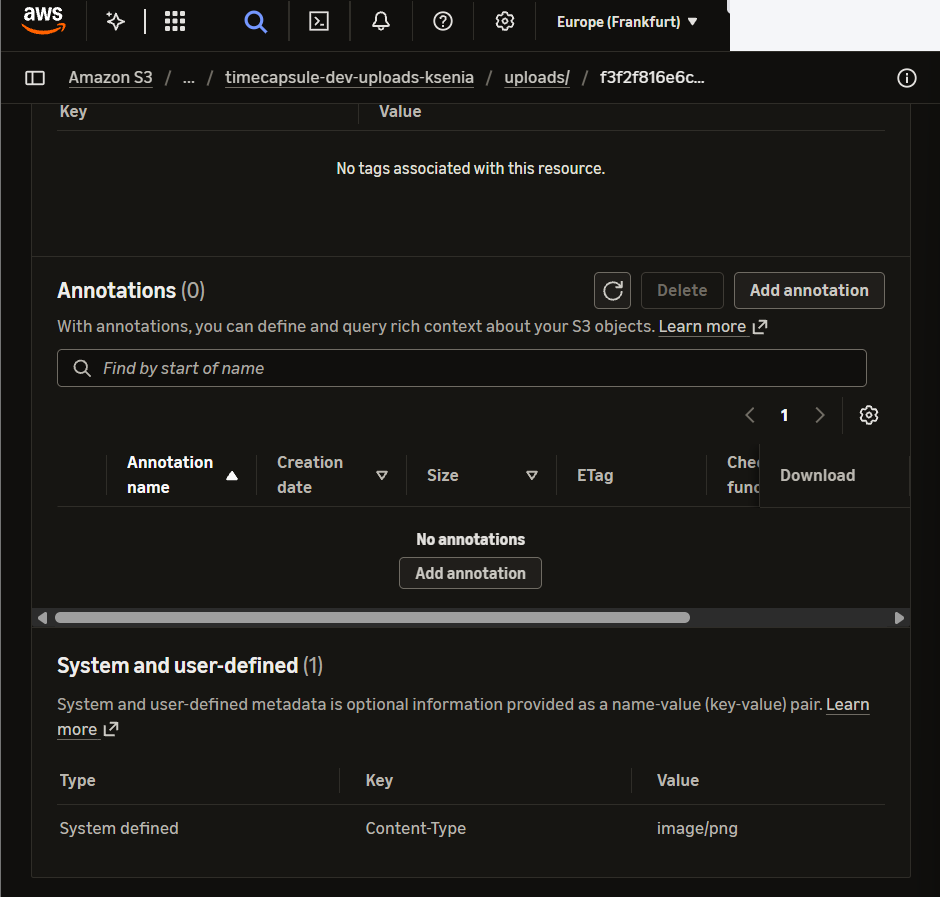

*Рисунок 05. Системные метаданные PNG: Content-Type = image/png.*

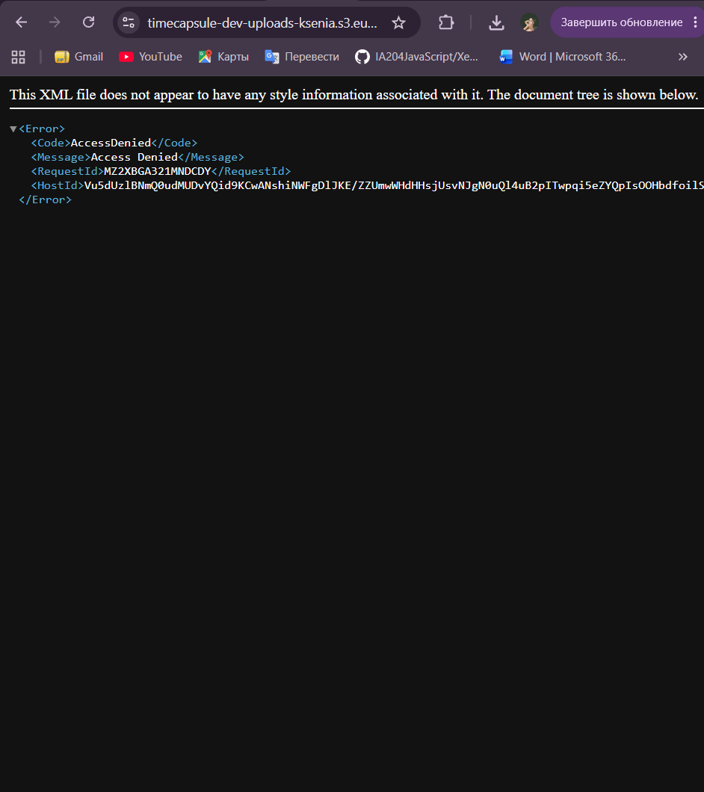

*Рисунок 06. Обычная прямая ссылка на приватный объект возвращает AccessDenied.*

**Контрольные вопросы (задание 1).** Ключ изображения — `uploads/f3f2f816e6c13a7f9aa671dc2c4c13e4.png`; это его полный путь внутри бакета. Прямая ссылка не открывается, потому что бакет приватный, а обычный запрос браузера не подписан и не имеет права `s3:GetObject`, даже если пользователь владеет аккаунтом. Кнопка **Create folder** создаёт объект-маркер с ключом, заканчивающимся `/` (например, `uploads/`), а не настоящую папку файловой системы; «папки» S3 определяются префиксами ключей.

### Задание 2. Объекты из командной строки

Через AWS CLI созданы три файла и загружены в бакет: `photo.txt` с помощью `cp`, каталог `2026/` с помощью `sync`. Затем выполнены три варианта `ls`, получены метаданные PNG и `report.txt` через `head-object` без скачивания; `photo.txt` скачан и прочитан, `report-2.txt` удалён.

```powershell
aws s3 cp photo.txt s3://timecapsule-dev-uploads-ksenia/uploads/photo.txt
aws s3 sync 2026 s3://timecapsule-dev-uploads-ksenia/uploads/2026
aws s3 ls s3://timecapsule-dev-uploads-ksenia
aws s3 ls s3://timecapsule-dev-uploads-ksenia/uploads/
aws s3 ls s3://timecapsule-dev-uploads-ksenia --recursive
aws s3api head-object --bucket timecapsule-dev-uploads-ksenia --key uploads/f3f2f816e6c13a7f9aa671dc2c4c13e4.png
aws s3api head-object --bucket timecapsule-dev-uploads-ksenia --key uploads/2026/10/report.txt
aws s3 cp s3://timecapsule-dev-uploads-ksenia/uploads/photo.txt downloaded.txt
Get-Content downloaded.txt
aws s3 rm s3://timecapsule-dev-uploads-ksenia/uploads/2026/10/report-2.txt
```

**Результат:** в корне `ls` показывает `PRE backups/` и `PRE uploads/`; внутри `uploads/` видна вложенная `PRE 2026/`, а `--recursive` выводит полные ключи. `head-object` показал для PNG `image/png` (218824 B) и для `report.txt` `text/plain` (16 B). После скачивания `downloaded.txt` содержит `photo placeholder`; удаление `report-2.txt` подтверждено строкой `delete:`.

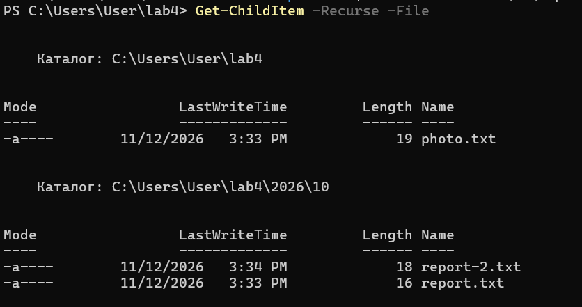

*Рисунок 07. Подготовлены локальные файлы photo.txt, report.txt и report-2.txt.*

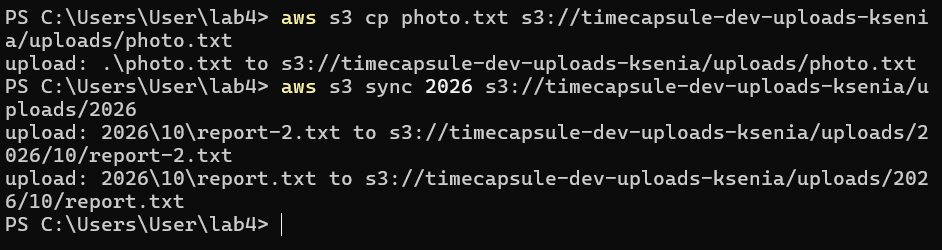

*Рисунок 08. Команды aws s3 cp и aws s3 sync успешно загрузили три объекта.*

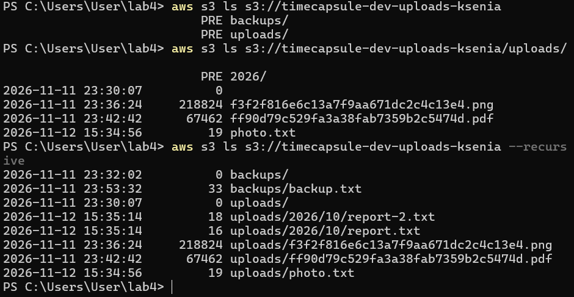

*Рисунок 09. Результаты трёх команд aws s3 ls, включая рекурсивный список ключей.*

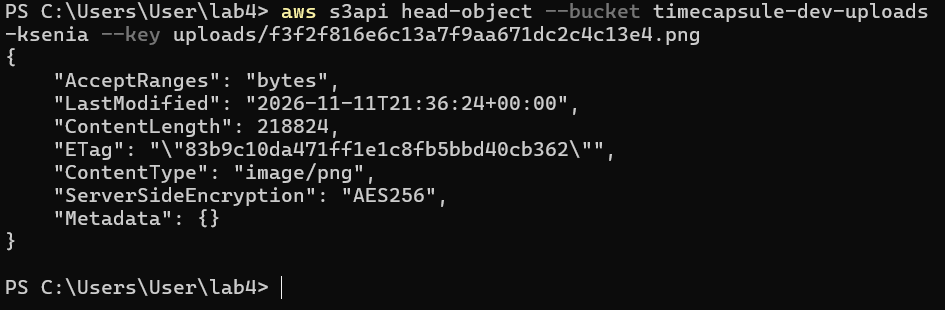

*Рисунок 10. Ответ head-object для PNG без скачивания объекта.*

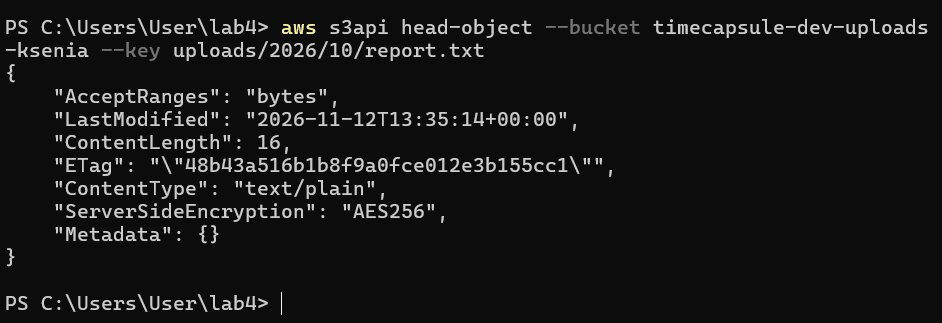

*Рисунок 11. Ответ head-object для report.txt: Content-Type = text/plain.*

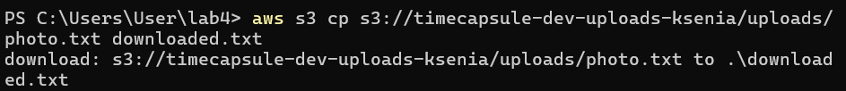

*Рисунок 12. Файл photo.txt скачан из S3 в downloaded.txt.*

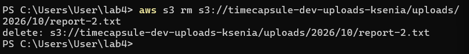

*Рисунок 13. Объект uploads/2026/10/report-2.txt удалён через AWS CLI.*

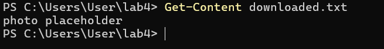

*Рисунок 14. Содержимое скачанного downloaded.txt: photo placeholder.*

**Контрольные вопросы (задание 2).** Обычный `aws s3 ls` группирует объекты по общим префиксам и выводит их как `PRE`, имитируя каталоги. Флаг `--recursive` отключает такое представление и показывает каждый объект с полным ключом. `report.txt` получил `Content-Type: text/plain`, поскольку AWS CLI определил MIME-тип по расширению `.txt` при загрузке.

### Задание 3. Политика бакета: только HTTPS

Добавлена политика `DenyInsecureTransport`, запрещающая любые действия с бакетом и объектами при `aws:SecureTransport=false`. Публичный доступ остался заблокированным.

```json
{
  "Version": "2012-10-17",
  "Statement": [
    {
      "Sid": "DenyInsecureTransport",
      "Effect": "Deny",
      "Principal": "*",
      "Action": "s3:*",
      "Resource": [
        "arn:aws:s3:::timecapsule-dev-uploads-ksenia",
        "arn:aws:s3:::timecapsule-dev-uploads-ksenia/*"
      ],
      "Condition": { "Bool": { "aws:SecureTransport": "false" } }
    }
  ]
}
```

```powershell
aws s3 ls s3://timecapsule-dev-uploads-ksenia/uploads/
aws s3 ls s3://timecapsule-dev-uploads-ksenia/uploads/ --endpoint-url http://s3.eu-central-1.amazonaws.com
```

**Результат:** HTTPS-запрос возвращает список объектов; HTTP-запрос — `AccessDenied` с пояснением `explicit deny in a resource-based policy`.

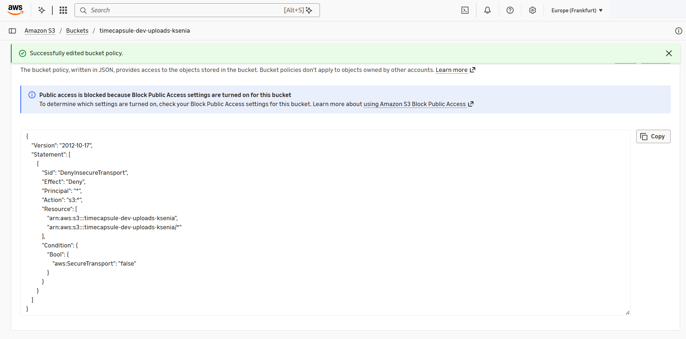

*Рисунок 15. В бакете сохранена политика с Deny для aws:SecureTransport=false.*

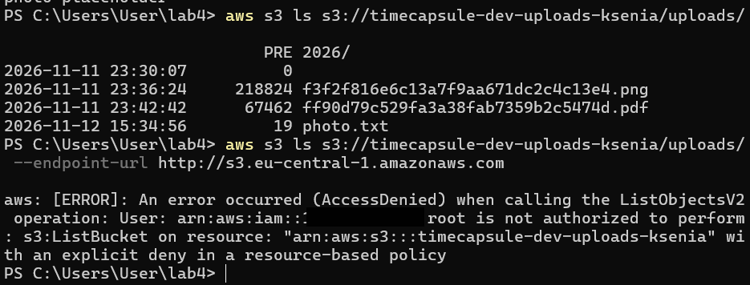

*Рисунок 16. HTTPS-запрос успешен, HTTP-запрос завершается AccessDenied.*

**Контрольные вопросы (задание 3).** Вторая команда получает `AccessDenied`, потому что явное запрещающее правило `Deny` действует даже при наличии прав администратора. `Block Public Access` не помешал сохранить политику с `Principal: "*"`, поскольку в ней нет `Allow`, предоставляющего публичные права: она лишь запрещает незащищённые соединения.

### Задание 4. Версионирование и защита от удаления

Включено `Bucket Versioning`. У загруженных ранее PNG, PDF и `photo.txt` при включении `Show versions` показан `Version ID: null`; затем в `uploads/notes.txt` загружены две версии с содержимым `v1` и `v2`. При обычном удалении объект исчез из текущего списка, но появился `Delete marker`, а обе версии сохранились. После удаления маркера восстановилась `v2`; затем версия `v2` была окончательно удалена, и активной стала исходная `v1`.

| Этап | Состояние `uploads/notes.txt` |
|---|---|
| Загрузка №1 | Создана версия `v1` с уникальным Version ID |
| Загрузка №2 | Создана новая `v2`, предыдущая `v1` сохранена |
| Удаление без Show versions | Добавлен `Delete marker`, версии `v1`/`v2` существуют |
| Удаление Delete marker | Снова доступна текущая версия `v2` |
| Удаление конкретной версии v2 | Текущей стала `v1`; v2 окончательно удалена |

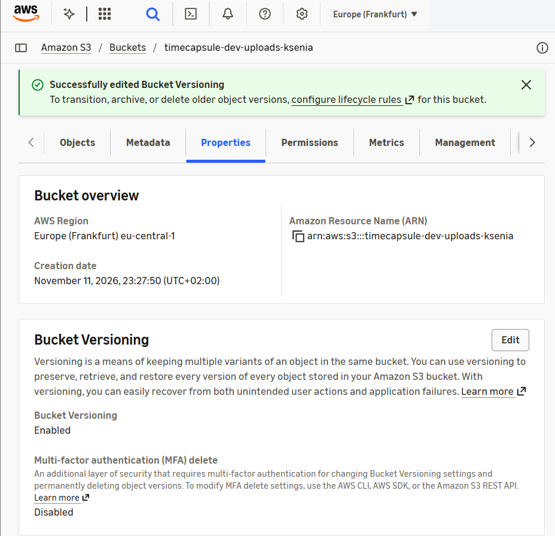

*Рисунок 17. Включено Bucket Versioning: Enabled.*

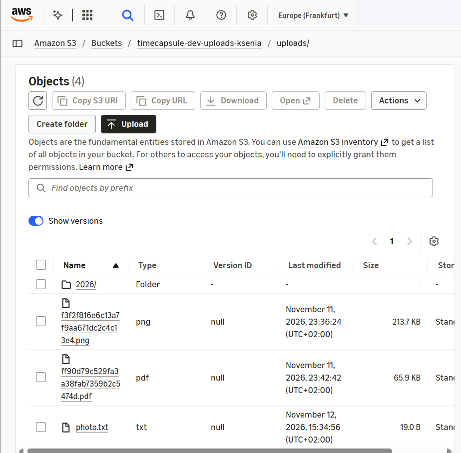

*Рисунок 18. Ранее загруженные объекты имеют Version ID = null.*

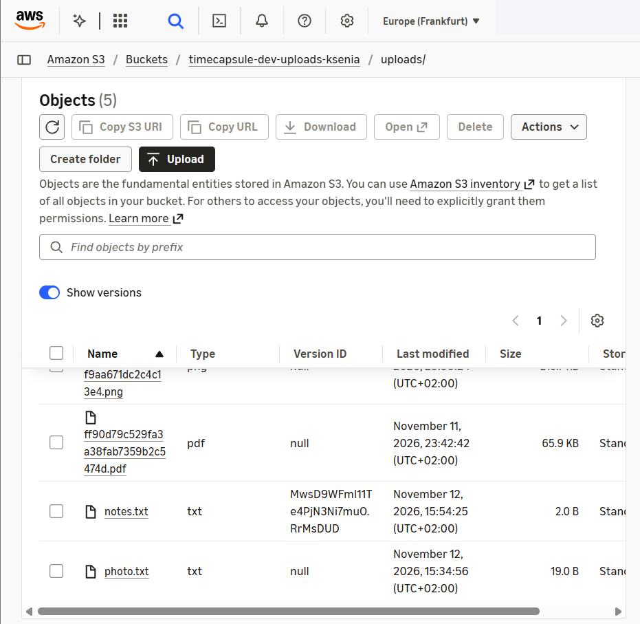

*Рисунок 19. Первичная загрузка notes.txt версии v1 с новым Version ID.*

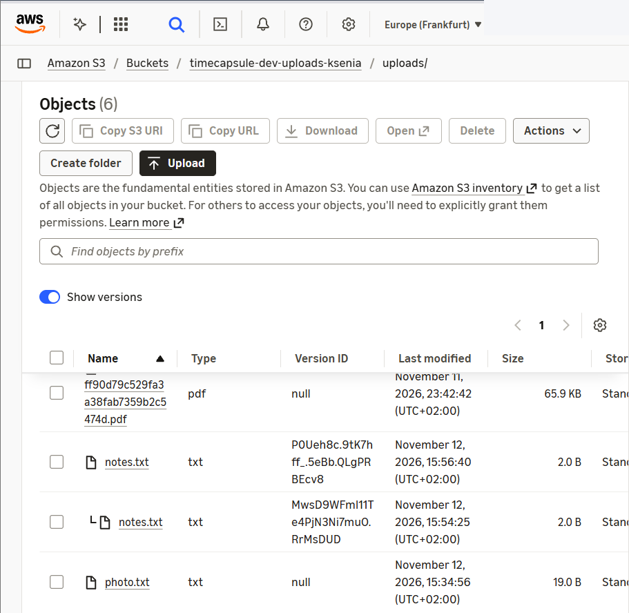

*Рисунок 20. После повторной загрузки доступны версии notes.txt: v2 и v1.*

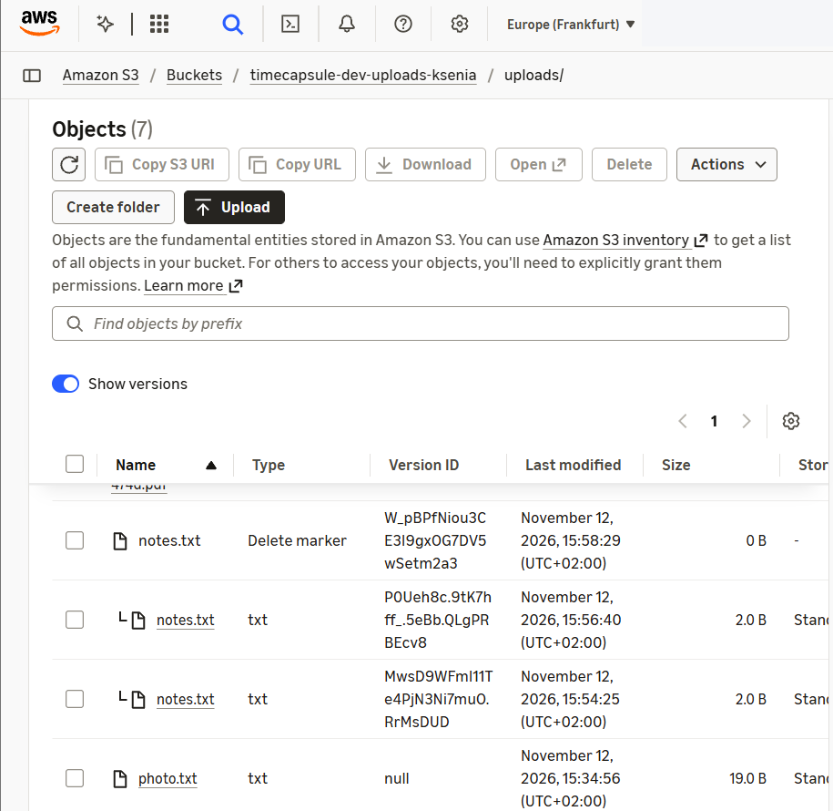

*Рисунок 21. При обычном удалении создан Delete marker; обе версии сохранились.*

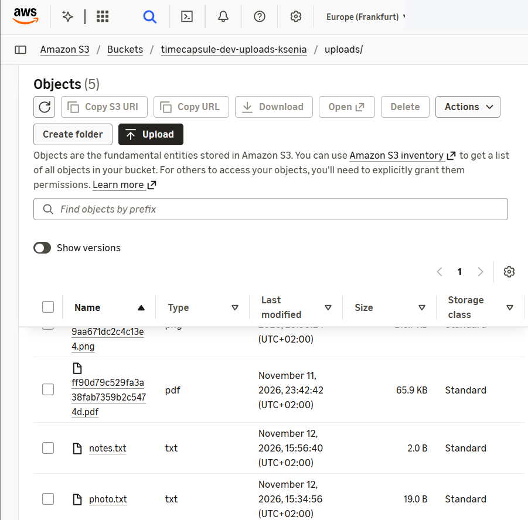

*Рисунок 22. После удаления маркера notes.txt восстановлен; актуальна v2.*

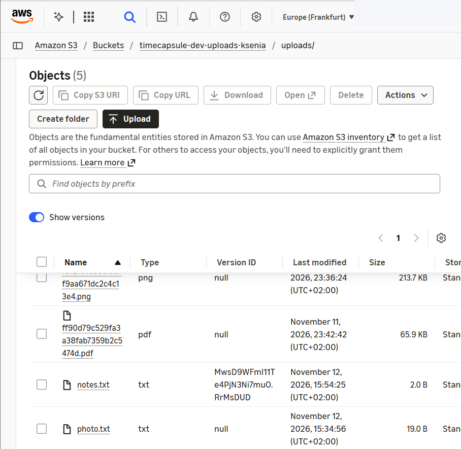

*Рисунок 23. После окончательного удаления версии v2 осталась версия v1.*

**Контрольные вопросы (задание 4).** Удаление без показа версий создаёт маркер удаления и скрывает текущий объект, не стирая прежние данные; эту операцию можно отменить, удалив маркер. Удаление конкретной версии при включённом `Show versions` окончательно удаляет её содержимое и обычным восстановлением маркера не отменяется. От случайных удалений защищает версионирование с маркерами, а приложениям следует запрещать `s3:DeleteObjectVersion`, чтобы они не могли уничтожать историю.

### Задание 5. Правило жизненного цикла

Создано и включено правило `timecapsule-dev-noncurrent`, область действия — только префикс `uploads/`; объекты `backups/` не затрагиваются.

| Параметр | Значение |
|---|---|
| Scope / Prefix | `uploads/` |
| Noncurrent transition | `Standard-IA` через 30 дней |
| Noncurrent expiration | Через 90 дней |
| Number of newer noncurrent versions to retain (при удалении) | `2` |
| Incomplete multipart uploads | Удалять через 7 дней |
| Default minimum object size for transitions | 128 КБ |
| Статус | Enabled |

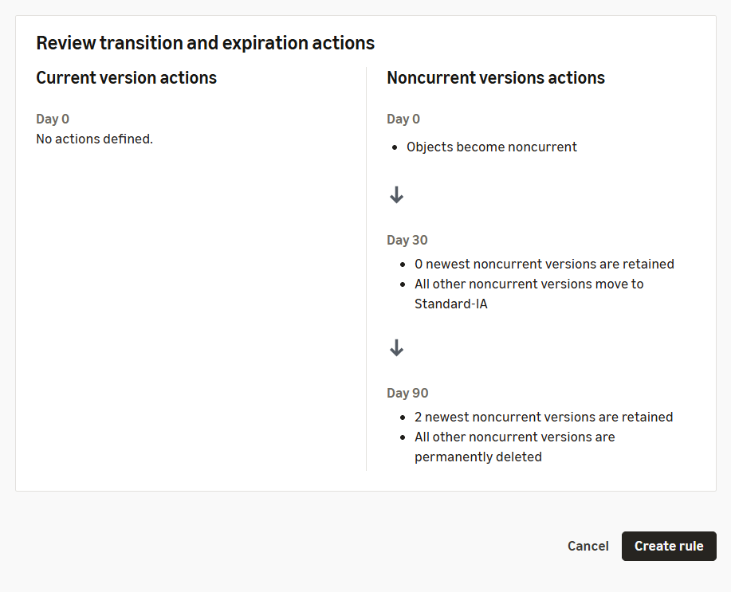

*Рисунок 24. Схема жизненного цикла: переход через 30 дней и удаление через 90 дней.*

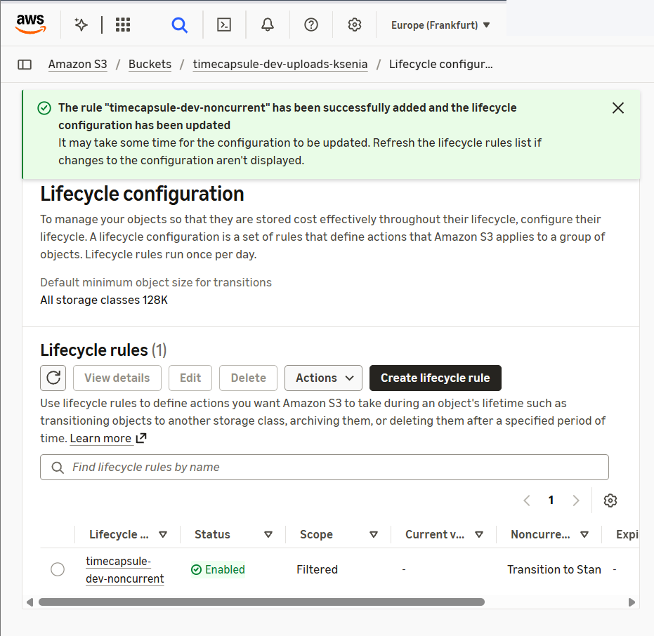

*Рисунок 25. Правило timecapsule-dev-noncurrent создано, Enabled.*

**Контрольные вопросы (задание 5).** Если файл переписан десять раз, образуется одна текущая и девять неактуальных версий. Подходящие неактуальные версии размером от 128 КБ через 30 дней после утраты актуальности переходят в Standard-IA; по достижении 90 дней версии могут удаляться, но две самые новые неактуальные сохраняются. Наши маленькие тестовые TXT меньше 128 КБ не переходят в Standard-IA по настройке S3 по умолчанию; незавершённая multipart-загрузка — это уже загруженные части большого объекта, который не был собран целиком, и за хранение частей могут начисляться платежи.

### Задание 6. Подписанные URL (presigned URL)

Для PNG из консоли создана подписанная ссылка на 5 минут; изображение открылось в приватном окне. Через CLI создана ссылка на `uploads/photo.txt` на 120 секунд; в браузере получен текст `photo placeholder`. При замене части пути `photo.txt` → `notes.txt` без изменения подписи AWS вернул `SignatureDoesNotMatch`; после истечения 120 секунд исходная ссылка вернула `AccessDenied` / `Request has expired`. Полные подписанные URL не включены в отчёт.

```powershell
aws s3 presign s3://timecapsule-dev-uploads-ksenia/uploads/photo.txt --expires-in 120 --region eu-central-1
```

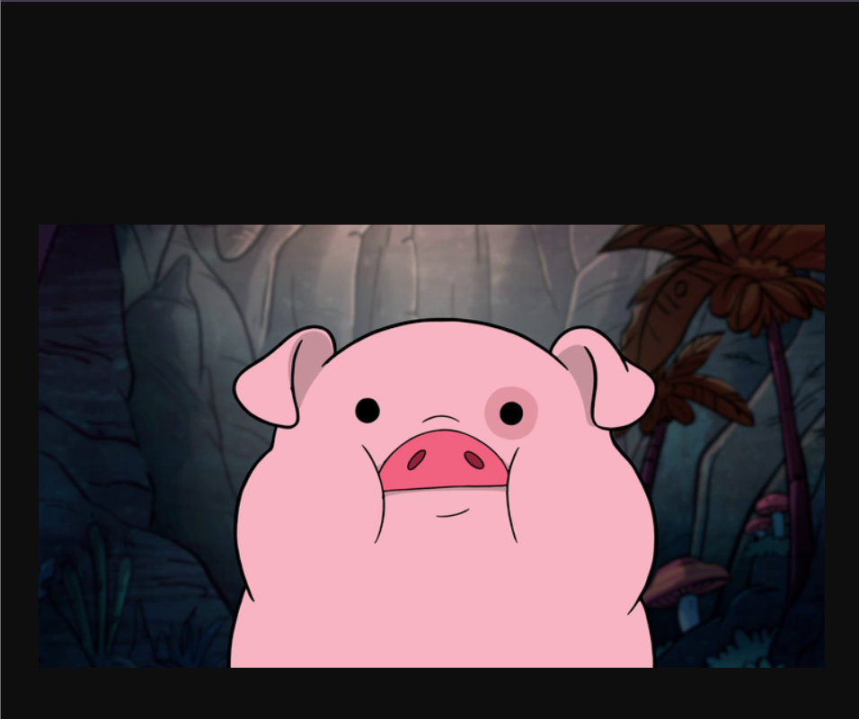

*Рисунок 26. Картинка открыта по 5-минутному подписанному URL из консоли.*

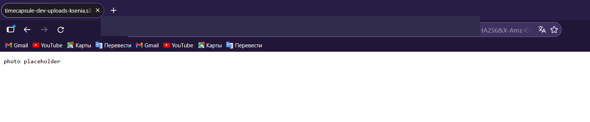

*Рисунок 27. По подписанному URL из CLI получен текст photo placeholder.*

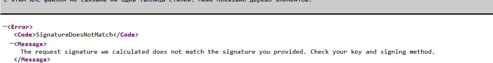

*Рисунок 28. При замене photo.txt на notes.txt получена ошибка SignatureDoesNotMatch.*

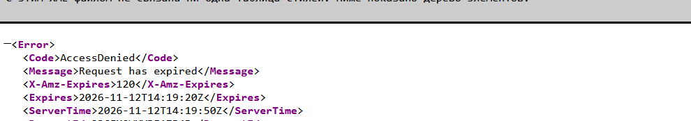

*Рисунок 29. После истечения срока подписанный URL возвращает AccessDenied: Request has expired.*

**Контрольные вопросы (задание 6).** При подмене ключа S3 вернул `SignatureDoesNotMatch`, а после истечения срока — `AccessDenied` с сообщением `Request has expired`. Нельзя получить другой файл простой заменой пути, поскольку ключ объекта входит в данные, для которых вычислена криптографическая подпись. Команда `aws s3 presign` формирует URL и его подпись локально на основе доступных AWS-учётных данных; для самого создания ссылки запрос к объекту S3 не требуется.

## Вывод

В ходе лабораторной работы я создала защищённый бакет Amazon S3 и освоила загрузку и управление файлами через консоль и AWS CLI. На практике проверила, что прямые ссылки на приватные объекты недоступны без разрешения, HTTPS можно принудительно обеспечить политикой бакета, а версионирование помогает восстанавливать данные после случайного удаления. Также настроила жизненный цикл для ограничения накопления старых версий и проверила, что временные подписанные ссылки работают только для указанного объекта и в пределах срока действия. 