# Лабораторная работа №3. Облачные сети — Amazon VPC

**Выполнила:** Scripnic Xenia  
**Группа:** IA2404  
**Специальность:** Прикладная информатика  
**Порядковый номер в группе:** `k = 26`; `X = k mod 30 = 26`  
**Уровень:** базовый (задания 1–7)  
**Регион AWS:** `eu-central-1` (Europe / Frankfurt)  

**Цель:** построить VPC с публичными и приватными подсетями, настроить маршрутизацию и фильтрацию трафика, временный выход приватного сервера в интернет через NAT Gateway и проверить изоляцию PostgreSQL.

## 1. План адресов (задание 1)

**VPC:** `timecapsule-dev-vpc`, `10.26.0.0/16`, ID `vpc-03ccec48955a2861f`.

| Подсеть | Зона | CIDR | Доступные для EC2 IPv4-адреса | Кол-во |
|---|---|---|---|---:|
| public-a | eu-central-1a | `10.26.0.0/24` | `10.26.0.4` — `10.26.0.254` | 251 |
| public-b | eu-central-1b | `10.26.1.0/24` | `10.26.1.4` — `10.26.1.254` | 251 |
| private-a | eu-central-1a | `10.26.10.0/24` | `10.26.10.4` — `10.26.10.254` | 251 |
| private-b | eu-central-1b | `10.26.11.0/24` | `10.26.11.4` — `10.26.11.254` | 251 |

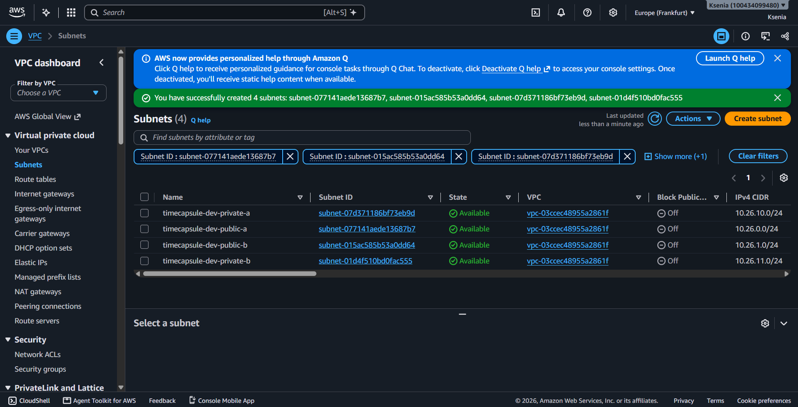

*В AWS созданы четыре подсети с запланированными CIDR в одной VPC.*

## 2. VPC и Internet Gateway (задания 2–3)

Для VPC включены DNS resolution и DNS hostnames. Шлюз `timecapsule-dev-igw` (`igw-0c12c3a492bb66227`) подключён к VPC.

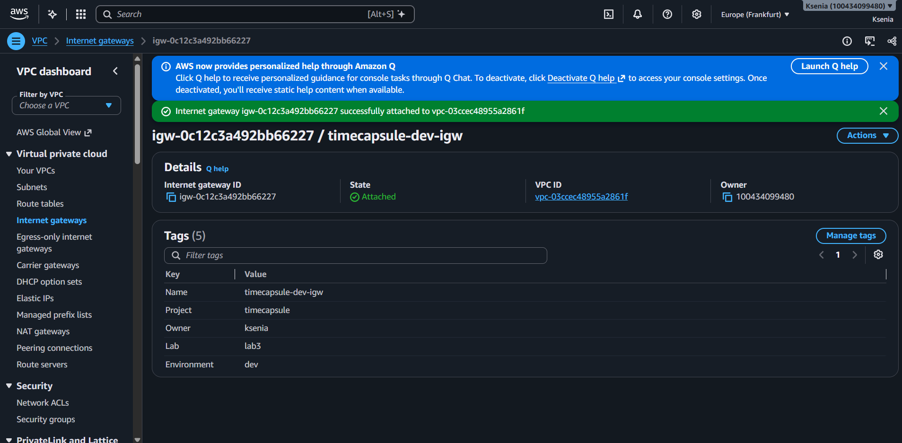

*Internet Gateway имеет состояние `Attached` и теги проекта.*

## 3. Таблицы маршрутов (задание 3)

### Публичная таблица `timecapsule-dev-public-rt`

ID: `rtb-0baff83f4d7a12e55`. Маршруты: `10.26.0.0/16 → local`, `0.0.0.0/0 → igw-0c12c3a492bb66227`; обе записи в состоянии `Active`.

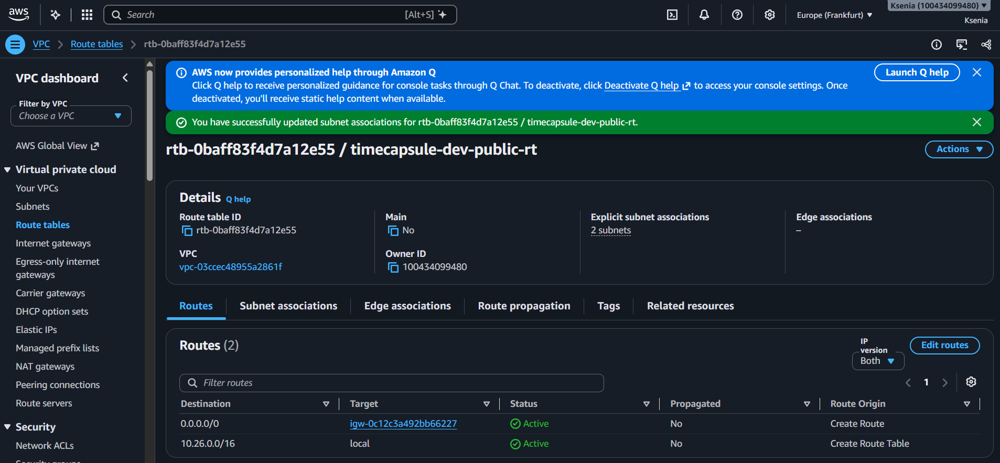

*Публичная таблица имеет локальный маршрут и маршрут в Internet Gateway.*

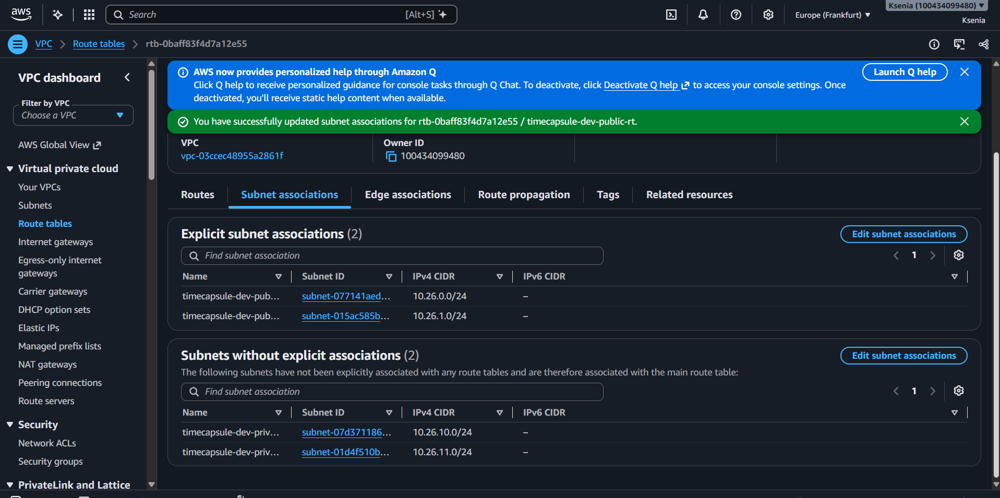

*Таблица `public-rt` явно связана с `public-a` и `public-b`.*

### Приватная таблица `timecapsule-dev-private-rt`

ID: `rtb-0e7328ba45748f4bf`. В окончательной конфигурации только `10.26.0.0/16 → local`; нет маршрута в интернет.

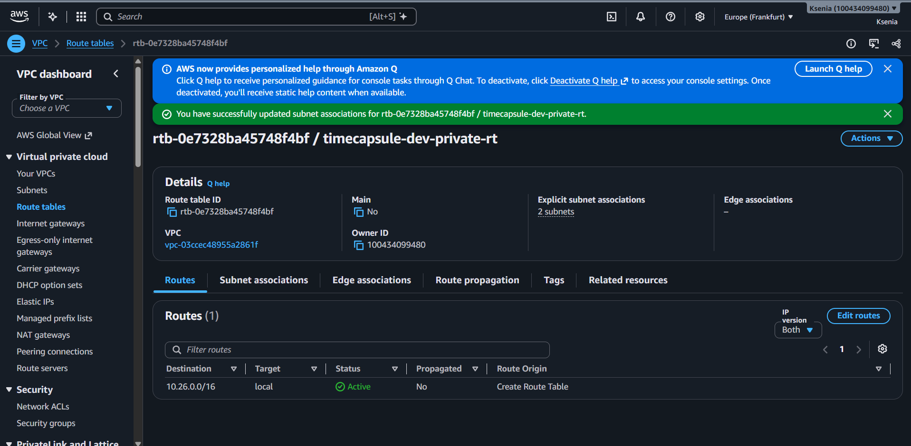

*До временного подключения NAT Gateway приватная таблица содержала только маршрут `local`.*

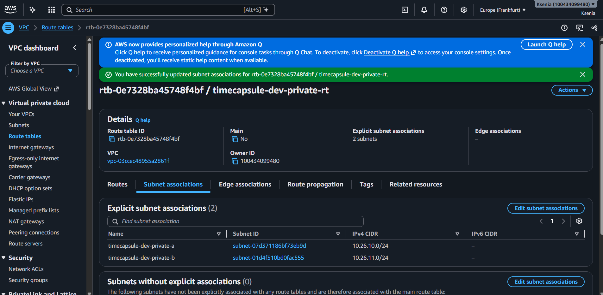

*Таблица `private-rt` явно связана с `private-a` и `private-b`.*

## 4. Security Groups (задание 4)

| Группа | Разрешённый входящий трафик | Источник |
|---|---|---|
| `timecapsule-dev-bastion-sg` | TCP 22 (SSH) | Внешний адрес администратора `/32` |
| `timecapsule-dev-web-sg` | TCP 80 (HTTP); TCP 22 (SSH) | `0.0.0.0/0`; `bastion-sg` |
| `timecapsule-dev-db-sg` | TCP 5432 (PostgreSQL); TCP 22 (SSH) | `web-sg`; `bastion-sg` |

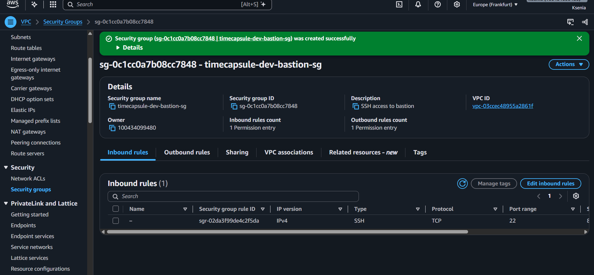

*Входящее правило `bastion-sg` разрешает SSH на порт 22; источник администратора в `/32` задан при создании.*

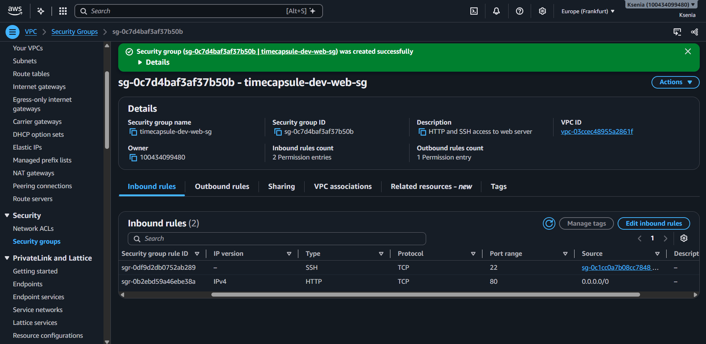

*`web-sg` разрешает HTTP с любых IPv4 и SSH только от группы bastion.*

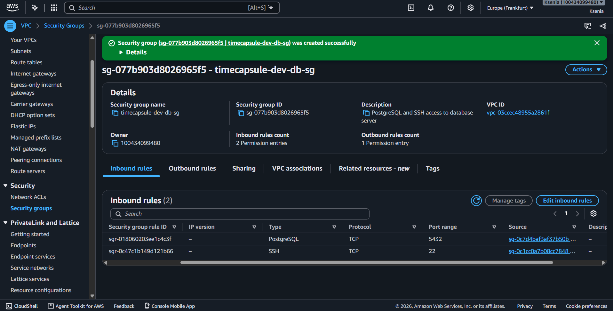

*`db-sg` разрешает PostgreSQL только от `web-sg`, а SSH только от `bastion-sg`.*

## 5. Экземпляры и проверка выхода в интернет (задание 5)

| Экземпляр | Роль | Подсеть | Приватный IP | Публичный IP во время проверки |
|---|---|---|---|---|
| `timecapsule-dev-bastion` | Jump host | public-b | `10.26.1.103` | `3.68.80.118` |
| `timecapsule-dev-web` | nginx | public-a | `10.26.0.74` | `52.58.130.47` |
| `timecapsule-dev-db` | PostgreSQL | private-a | `10.26.10.105` | нет |

Публичные адреса EC2 были временными и после остановки экземпляров могут измениться. SSH-переход с компьютера к `web` и `db` проверен через bastion (`ProxyJump bastion`); приватный ключ не копировался на сервер.

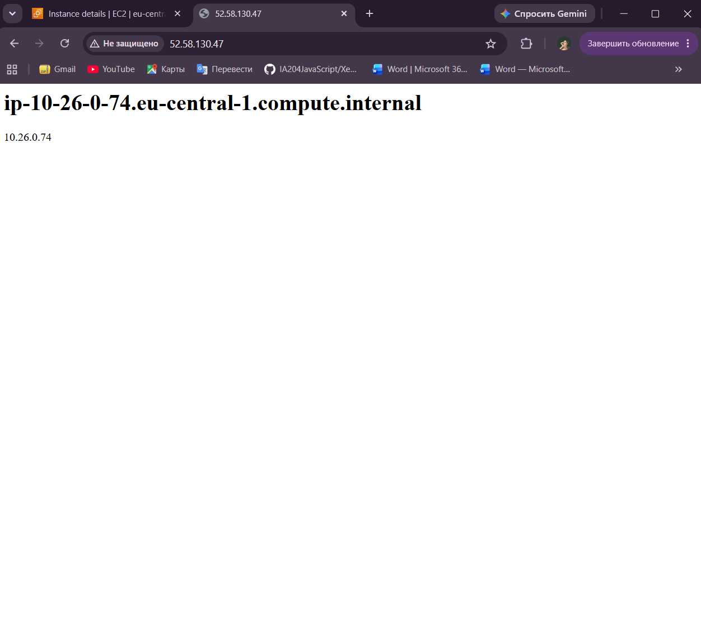

*nginx отвечает по HTTP; на странице видны имя хоста и его приватный IP `10.26.0.74`.*

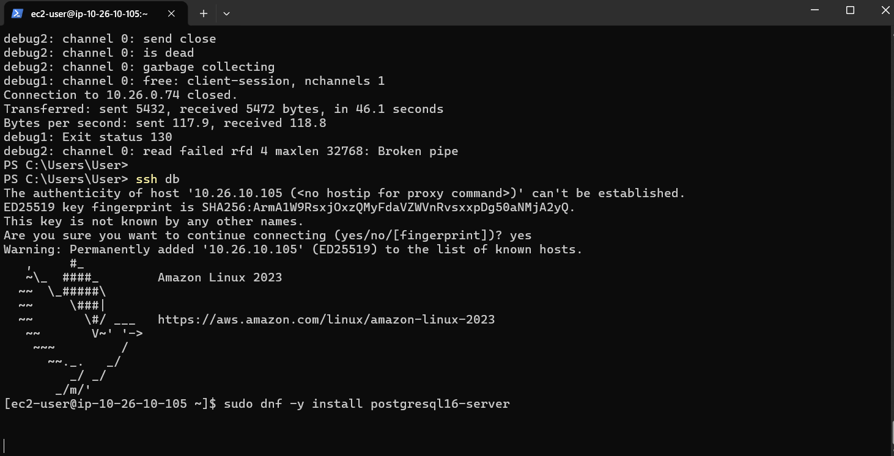

*Попытка `sudo dnf -y install postgresql16-server` на приватном сервере не продвигается без маршрута во внешнюю сеть.*

## 6. Временный NAT Gateway (задание 6)

NAT Gateway `timecapsule-dev-nat-a` (`nat-071d7f468c49e4d1c`) создан в `public-a`; его Elastic IP во время работы — `63.180.80.85`. Временно добавлен маршрут `0.0.0.0/0 → NAT Gateway` в `private-rt`. После этого `sudo dnf -y update` завершилось с `Complete!`, `postgresql16-server` установился успешно, а служба PostgreSQL запущена (`active (running)`). Созданы роль `student` и база `lab3`.

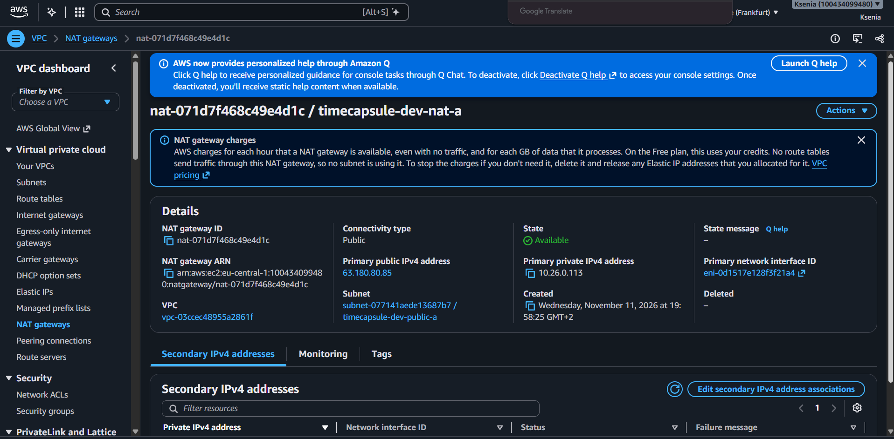

*Шлюз в состоянии `Available`; в его деталях указан Elastic IP `63.180.80.85`.*

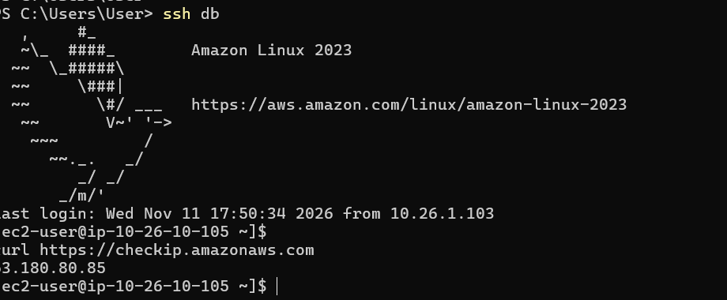

*На `db-server` команда `curl https://checkip.amazonaws.com` вернула адрес NAT Gateway; у исходного скриншота слегка обрезан левый край вывода.*

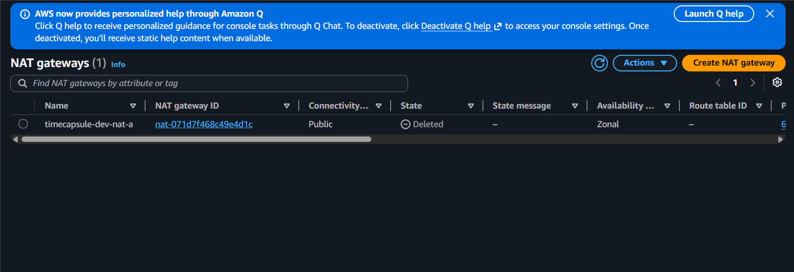

*После установки PostgreSQL NAT Gateway удалён: `State = Deleted`.*

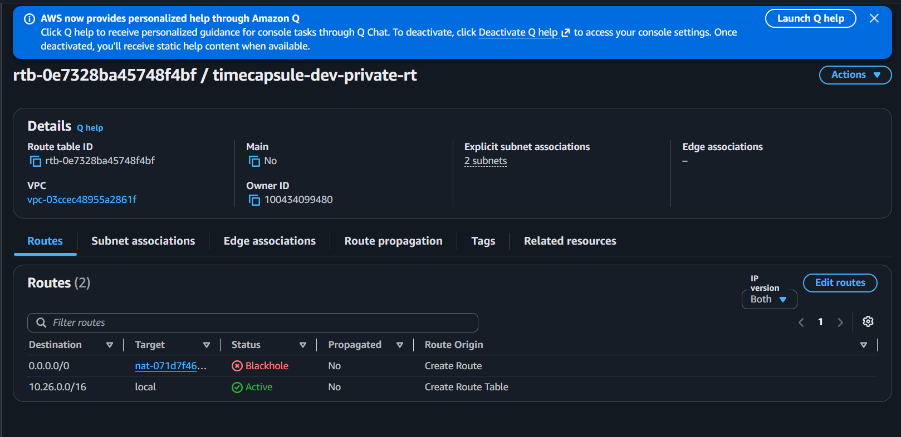

*После удаления шлюза маршрут `0.0.0.0/0` временно получил статус `Blackhole`; затем этот маршрут удалён.*

## 7. Проверки безопасности (задание 7)

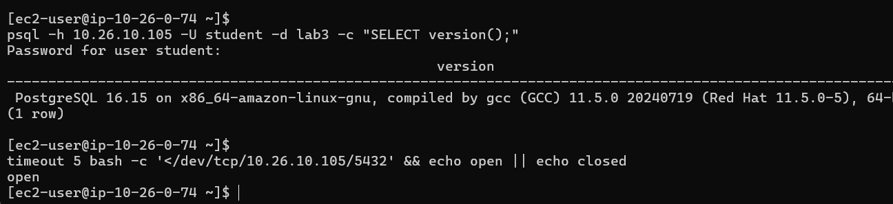

*`psql` с web-server вывел PostgreSQL 16.15 `(1 row)`, а проверка порта 5432 вернула `open`.*

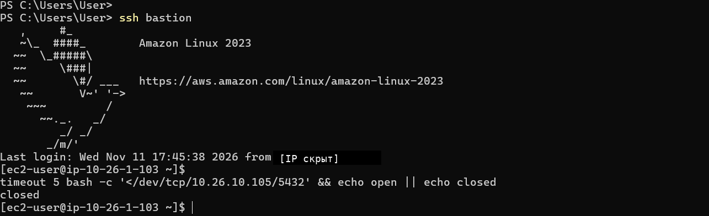

*Проверка доступа к `10.26.10.105:5432` с bastion вернула `closed`.*

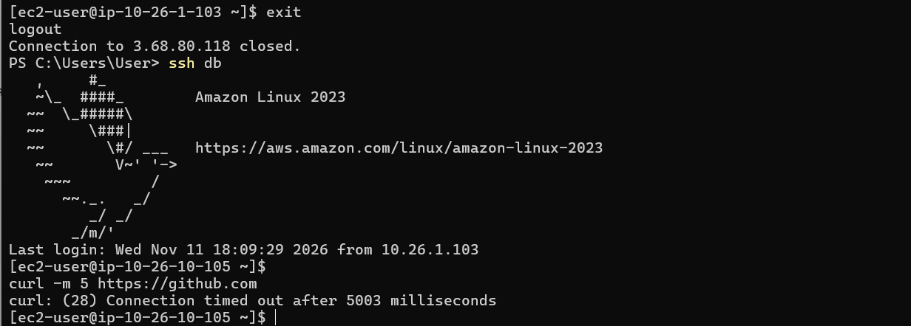

*После удаления NAT запрос `curl -m 5 https://github.com` с db-server завершился тайм-аутом.*

### Network ACL

В Network ACL `acl-079d5cb7a1c28545a` временно добавлено правило `90 / All traffic / <IP администратора>/32 / Deny`, которое обрабатывалось раньше `100 / Allow`.

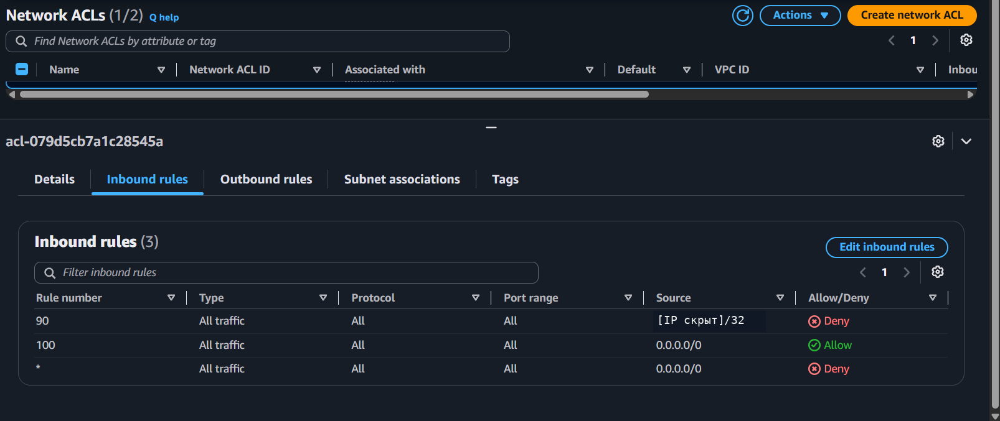

*Правило 90 запрещает трафик от проверяемого внешнего адреса; полный адрес на скриншоте скрыт.*

Проверка SSH с компьютера показала:

```text
PS C:\Users\User> ssh -o ConnectTimeout=5 bastion
ssh: connect to host 3.68.80.118 port 22: Connection timed out
```

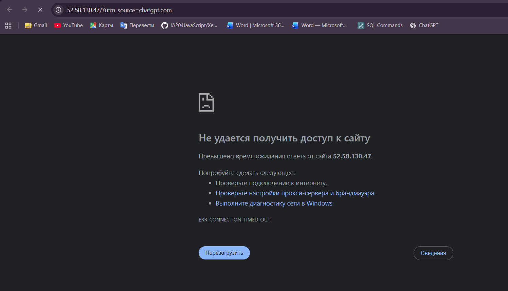

*Во время действия правила 90 запрос к веб-серверу завершился `ERR_CONNECTION_TIMED_OUT`.*

Проверка с телефона также не прошла, потому что телефон и компьютер использовали один мобильный интернет и один внешний IP. После удаления правила 90 сайт восстановился.

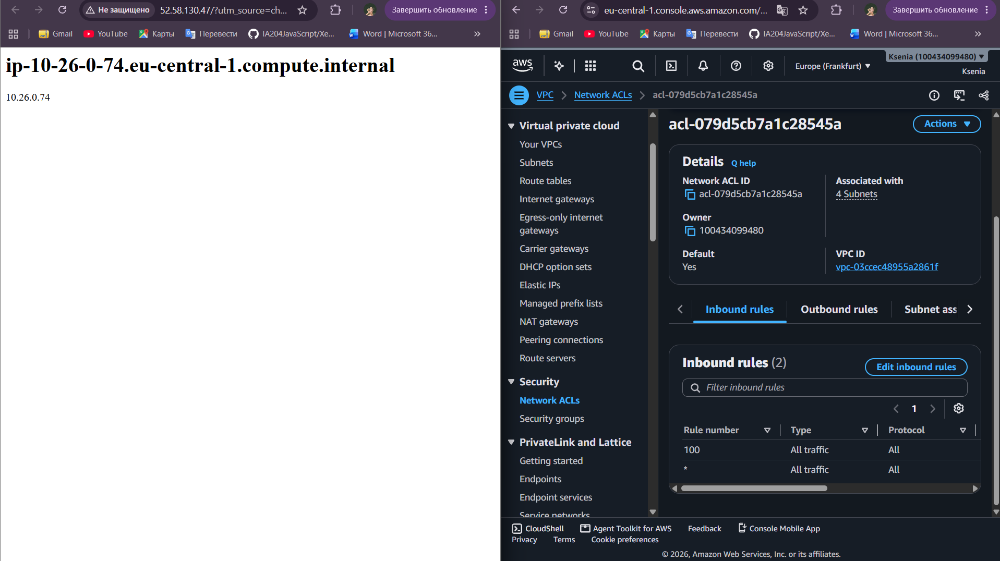

*После удаления правила 90 в ACL остались правила 100 и `*`, а сайт снова открылся.*

### Теги ресурсов

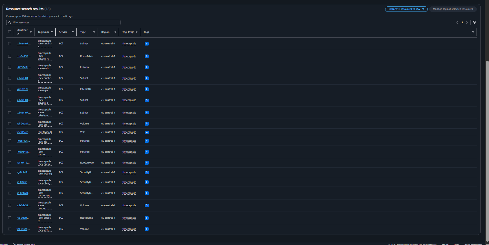

*Tag Editor нашёл 18 ресурсов в `eu-central-1` по фильтру `Project = timecapsule`.*

На момент снимка у VPC отсутствовал тег `Name`, после проверки он был добавлен со значением `timecapsule-dev-vpc`. Запись о ранее удалённом NAT Gateway могла временно сохраняться в результатах поиска.

## 8. Итоговое состояние

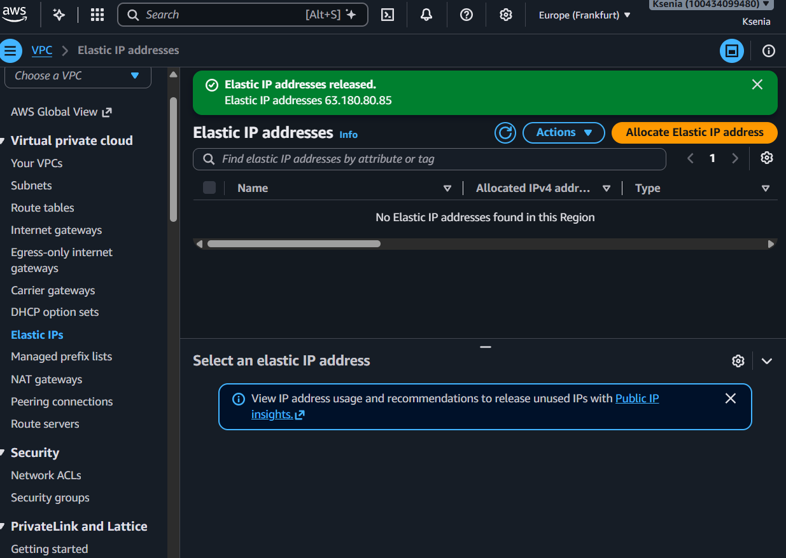

*После удаления NAT Gateway выделенных Elastic IP в регионе не осталось.*

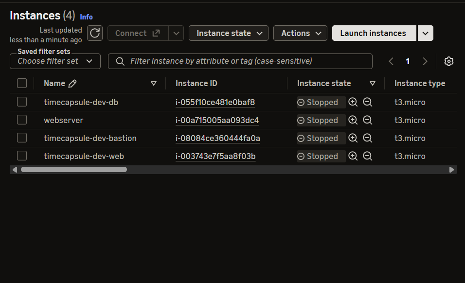

*Три учебных экземпляра остановлены (`Stopped`); старый сервер ЛР2 не изменялся.*

-NAT Gateway удалён, временный маршрут `Blackhole` и правило Network ACL № 90 удалены, Elastic IP освобождён. Диски EBS продолжают существовать, поэтому их хранение может тарифицироваться даже при остановленных EC2.

## 9. Ответы на контрольные вопросы

**Задание 1. Почему в /24 не 256 доступных адресов, что резервирует AWS и сколько /24 ещё помещается в VPC?**  
В /24 содержится 256 IPv4-адресов, но AWS резервирует первые четыре (`.0` — адрес сети, `.1` — маршрутизатор VPC, `.2` — DNS, `.3` — для будущего использования) и последний (`.255` — резерв), поэтому для EC2 остаётся 251. В диапазоне /16 помещаются 256 подсетей /24, четыре уже использованы, значит остаются 252.

**Задание 2. Является ли public-a публичной сразу после создания?**  
Нет: название и принадлежность к VPC не делают подсеть публичной. Публичной она становится после настройки маршрута `0.0.0.0/0` через Internet Gateway; для связи с интернетом экземпляру также необходим публичный IP.

**Задание 3. Какой маршрут есть в обеих таблицах и куда пойдёт пакет из private-a к 8.8.8.8?**  
Маршрут `10.26.0.0/16 → local` создаётся автоматически и обеспечивает связь между подсетями одной VPC. В окончательной `private-rt` нет маршрута к `8.8.8.8`, поэтому пакет не будет отправлен в интернет.

**Задание 4. Почему источником PostgreSQL указан web-sg, а не IP или вся VPC?**  
Ссылка на `web-sg` разрешает доступ только интерфейсам, на которых назначена эта группа, а не всем узлам сети. Это безопаснее диапазона `10.26.0.0/16` и не требует менять правило при изменении IP веб-сервера.

**Задание 5. Почему db-server сначала не скачивал пакеты и как дать ему интернет без публичного доступа?**  
У сервера не было публичного IP и в приватной таблице не было маршрута во внешнюю сеть. Временный публичный NAT Gateway и маршрут к нему позволяют инициировать исходящие подключения, не принимая новые подключения из интернета к db-server.

**Задание 6. Какой адрес вернул `checkip.amazonaws.com` и почему не адрес db-server?**  
Команда вернула `63.180.80.85` — Elastic IP временного NAT Gateway. NAT подменяет исходный адрес исходящих соединений своим публичным адресом, тогда как `db-server` имеет только приватный `10.26.10.105`.

**Задание 6. Как три механизма ограничивают доступ к PostgreSQL и что будет при ошибке в одном?**  
Отсутствие публичного IP и внешнего маршрута изолирует базу от интернета, `db-sg` разрешает TCP 5432 только от `web-sg`, а `pg_hba.conf` допускает вход по паролю из `10.26.0.0/24`. Они дополняют друг друга: ошибка в одном может ослабить защиту или сломать легитимный доступ, но другие ограничения продолжат действовать.

**Задание 6. Почему PostgreSQL работает после удаления NAT и как ставить обновления?**  
Служба PostgreSQL работает локально на EC2, а обмен данными с `web-server` идёт по маршруту `local` внутри VPC; NAT для этого не нужен. Для скачивания новых пакетов нужно снова временно создать NAT Gateway и маршрут к нему либо использовать согласованный закрытый канал доставки обновлений.

**Задание 7. Почему порт 5432 открыт с web-server, но закрыт с bastion?**  
Маршрут `local` делает серверы достижимыми на сетевом уровне, но `db-sg` отдельно фильтрует входящие соединения. Для TCP 5432 источником указан `web-sg`, а не `bastion-sg`, поэтому результаты проверки различаются.

**Задание 7. Почему `curl` с db-server не проходит и можно ли из интернета подключиться к PostgreSQL?**  
После удаления NAT Gateway в `private-rt` остался только маршрут `local`, поэтому обращение к `github.com` извне VPC завершается тайм-аутом. Подключение к 5432 из интернета также невозможно: у db-server нет публичного адреса и внешнего маршрута, а Security Group допускает соединение только от `web-sg`.

**Задание 7. Почему Network ACL заблокировал SSH и HTTP, почему могла помочь другая сеть и зачем номер 90?**  
Network ACL фильтрует трафик для подсетей независимо от Security Groups; правило `90 Deny` имело приоритет над `100 Allow`, поэтому блокировало и SSH, и HTTP с указанного IP. Действительно другая мобильная сеть с иным публичным IP не попала бы под запрет, но в нашем опыте оба устройства делили одно мобильное подключение и блокировались вместе.

**Задание 7. Как найти все ресурсы проекта по тегам и зачем Owner в личном аккаунте?**  
В Tag Editor выбирают `eu-central-1`, все поддерживаемые типы ресурсов и фильтр `Project = timecapsule`, после чего получают перечень ресурсов для проверки и последующего удаления. Тег `Owner` показывает ответственного за ресурс даже в личном аккаунте и пригодится при совместной работе, передаче проекта или разборе расходов.

---