# Лабораторная работа №2. Amazon EC2: развёртывание и администрирование веб-сервера

**Дисциплина:** Облачные вычисления (Cloud Computing)  
**Университет:** Государственный университет Молдовы (USM)  
**Факультет:** Математики и информатики  
**Специальность:** Прикладная информатика, III курс  
**Студентка:** Xenia Scripnic  
**Среда выполнения:** AWS Management Console, Amazon Linux 2023, Windows PowerShell  
**Регион AWS:** Europe (Frankfurt), `eu-central-1`

## Цель работы

Получить практические навыки управления доступом в AWS, запуска виртуального сервера Amazon EC2, настройки сетевого доступа и автоматической установки программ через User Data. Научиться проверять состояние экземпляра, анализировать диагностические данные, подключаться по SSH, размещать веб-страницы на Nginx и останавливать экземпляр с помощью AWS CLI.

## 1. Управление доступом и контроль расходов

В AWS Identity and Access Management (IAM) создана группа **`Admins`** с управляемой политикой **`AdministratorAccess`**. Создан пользователь **`cloudstudent`**, добавленный в эту группу. Такой подход позволяет назначать разрешения группе и управлять доступом пользователей централизованно.

Для контроля возможных расходов предусмотрен бюджет AWS Budgets с нулевым целевым порогом (**ZeroSpend**). Следует учитывать, что бюджет и уведомления не блокируют платные ресурсы автоматически; фактические расходы необходимо проверять отдельно в Billing.

> **Примечание по подтверждению:** в имеющемся наборе иллюстраций нет отдельного снимка итоговых настроек IAM и ZeroSpend. Их создание отражено в ходе выполнения работы, но визуальное подтверждение в этот отчёт не включено.

## 2. Создание и настройка EC2

### 2.1. Параметры экземпляра

В разделе **EC2 → Instances → Launch instances** задана следующая конфигурация:

| Параметр | Значение |
|---|---|
| Имя экземпляра | `webserver` |
| Образ (AMI) | Amazon Linux 2023, x86_64 |
| Тип | `t3.micro` |
| Регион | `eu-central-1` (Frankfurt) |
| VPC | VPC по умолчанию, `172.31.0.0/16` |
| Подсеть | Автоматический выбор |
| Публичный IPv4 | Автоматическое назначение включено |
| Диск | 8 GiB, Amazon EBS `gp3` |
| Группа безопасности | `webserver-sg` |
| Ключ | `Ksenia-key`, ED25519, формат `.pem` |

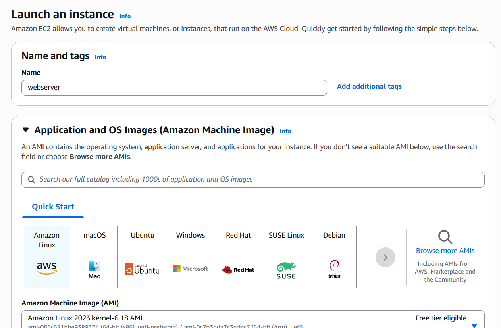

*Рисунок 1 — Создание экземпляра `webserver`.*

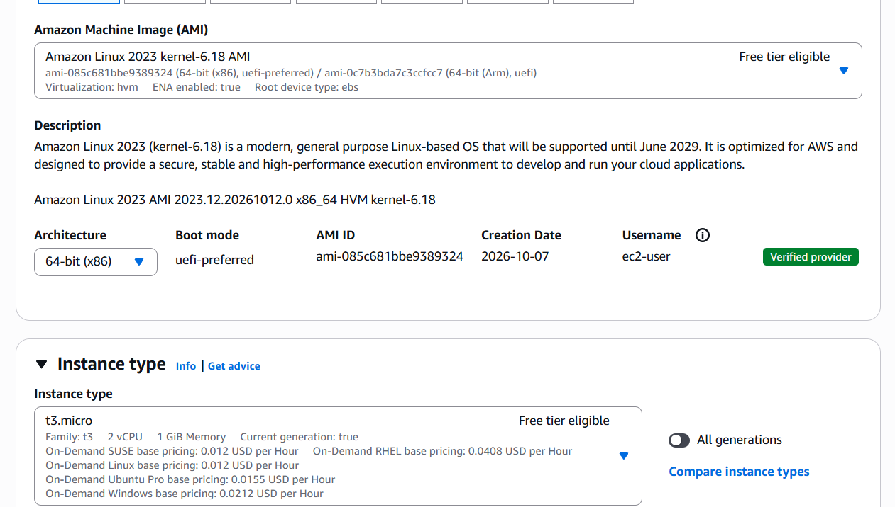

*Рисунок 2 — Amazon Linux 2023 и тип `t3.micro`.*

### 2.2. Пара ключей SSH

Создана пара ключей **`Ksenia-key`** с алгоритмом **ED25519**. Приватный ключ сохранён локально в формате `.pem` и перемещён в каталог Windows `%USERPROFILE%\.ssh`.

```powershell
Move-Item "$HOME\Downloads\Ksenia-key.pem" "$HOME\.ssh\"
Test-Path "$HOME\.ssh\Ksenia-key.pem"
```

Проверка `Test-Path` вернула `True`, то есть файл доступен по указанному пути. **Приватный ключ не загружается в GitHub и не публикуется в отчёте.**

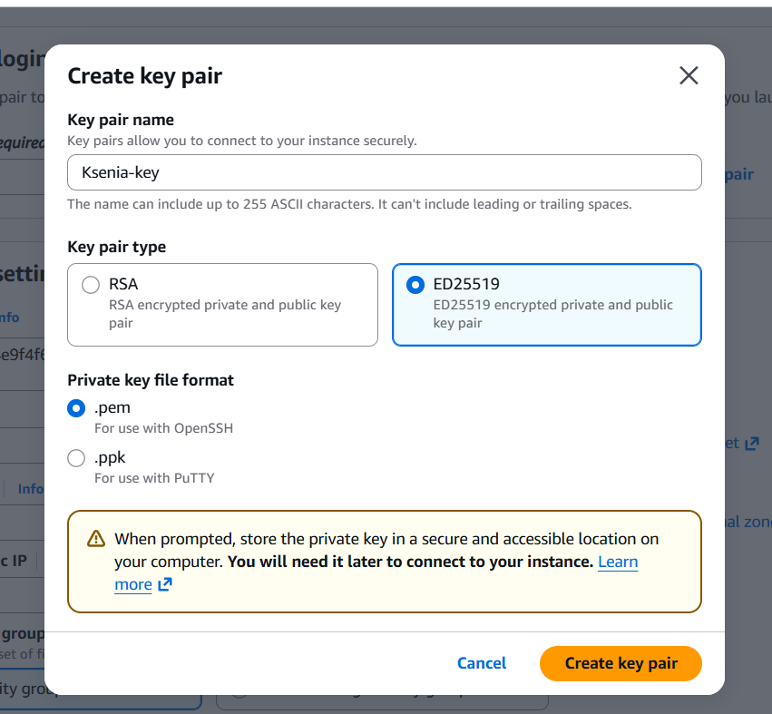

*Рисунок 3 — Настройка ключа ED25519.*

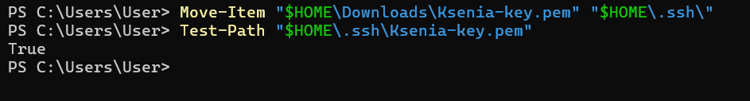

*Рисунок 4 — Проверка локального файла ключа в PowerShell.*

### 2.3. Сетевые правила

Создана группа безопасности `webserver-sg` с входящими правилами:

| Протокол | Порт | Источник | Назначение |
|---|---:|---|---|
| SSH / TCP | 22 | My IP (`/32`) | Административное подключение с разрешённого адреса |
| HTTP / TCP | 80 | `0.0.0.0/0` | Доступ к сайту из интернета |

Ограничение SSH по текущему публичному IP уменьшает поверхность атаки. При изменении внешнего адреса компьютера правило **My IP** необходимо обновить. HTTP открыт всем адресам, поскольку веб-сервер должен быть доступен в браузере.

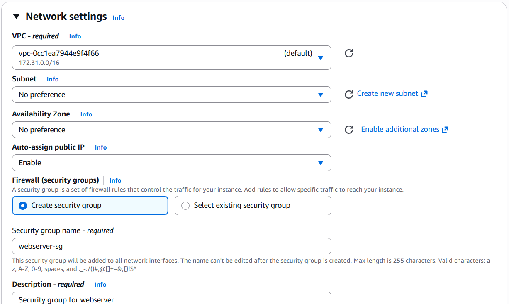

*Рисунок 5 — Настройка входящих правил Security Group.*

### 2.4. Дисковое пространство

Для корневого раздела выделен том Amazon EBS **8 GiB, `gp3`**. EBS обеспечивает блочное постоянное хранилище, данные которого могут сохраняться при остановке экземпляра.

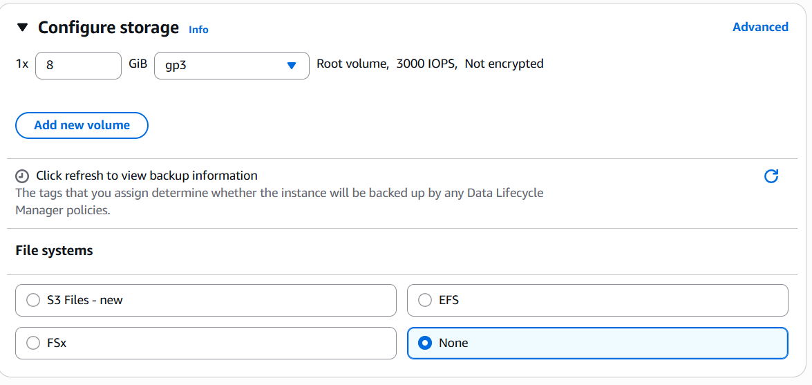

*Рисунок 6 — Корневой том EBS `gp3`.*

### 2.5. Автоматическая установка Nginx и htop

В поле **Advanced details → User data** добавлен сценарий:

```bash
#!/bin/bash
dnf -y update
dnf -y install htop nginx
systemctl enable --now nginx
```

Назначение команд:

1. `dnf -y update` — обновление доступных пакетов.
2. `dnf -y install htop nginx` — установка монитора процессов `htop` и веб-сервера Nginx.
3. `systemctl enable --now nginx` — запуск Nginx и включение автозапуска при загрузке системы.

В стандартной конфигурации EC2 User Data обрабатывается `cloud-init` при первом запуске экземпляра. Успешное выполнение следует проверять по журналам и состоянию службы.

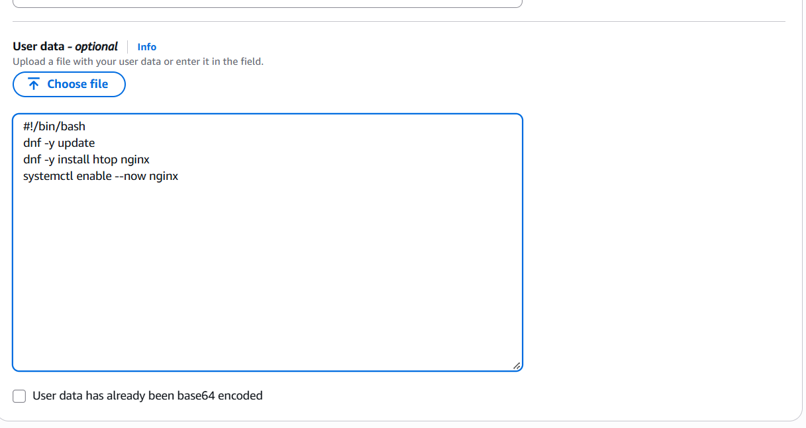

*Рисунок 7 — Автоматическая установка ПО через User Data.*

### 2.6. Запуск экземпляра

После проверки параметров нажата кнопка **Launch instance**. AWS подтвердил успешную инициализацию экземпляра.

**Идентификатор экземпляра:** `i-00a715005aa093dc4`.

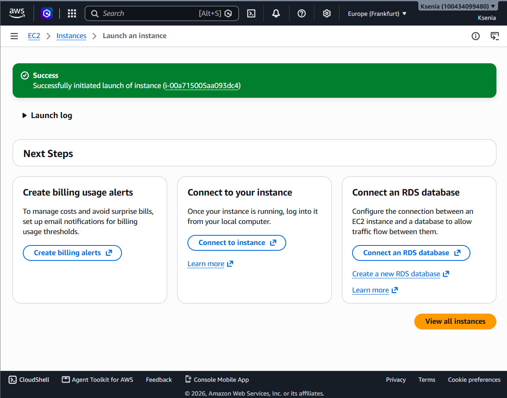

*Рисунок 8 — Сообщение об успешном запуске EC2.*

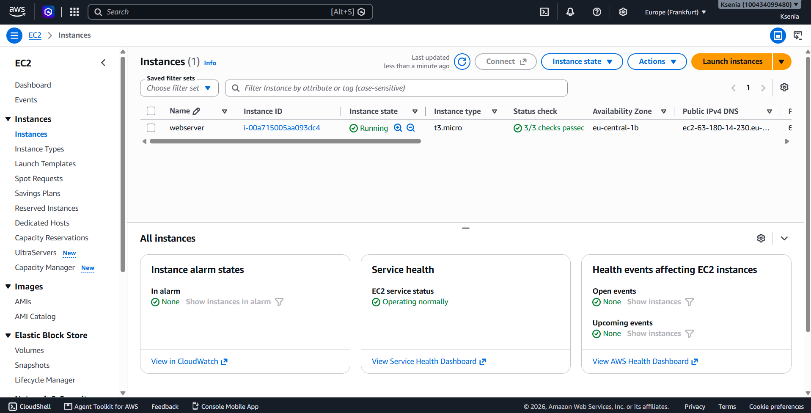

*Рисунок 9 — Экземпляр `webserver` в AWS Console.*

## 3. Проверка работы сервера и диагностика

### 3.1. Проверки состояния

В разделе **Status checks** успешно пройдены все три проверки:

- **System status check** — состояние инфраструктуры AWS, на которой работает экземпляр.
- **Instance status check** — доступность и работоспособность гостевой виртуальной машины.
- **EBS status check** — доступность подключённого хранилища EBS.

**Результат: 3/3 — Check passed.**

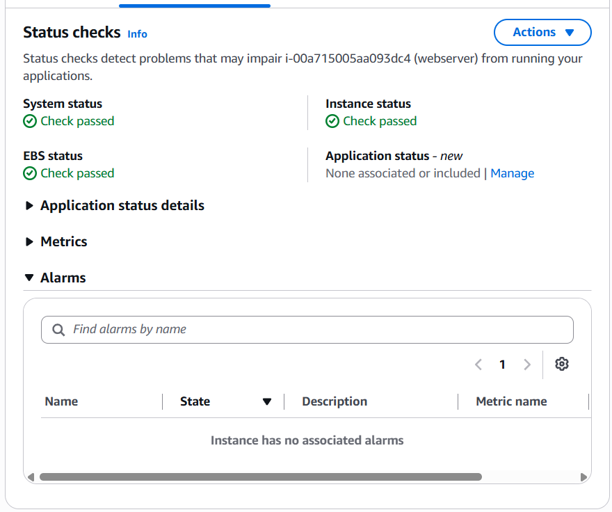

*Рисунок 10 — Успешные проверки System, Instance и EBS.*

### 3.2. Проверка HTTP

На этапе выполнения экземпляру был назначен публичный адрес **`63.180.14.230`**. В браузере открыт адрес:

```text
http://63.180.14.230
```

Отобразилась стандартная страница **Welcome to nginx!**, что подтвердило работу веб-сервера и доступность порта 80. Публичный IPv4, назначенный автоматически, может измениться после остановки и повторного запуска экземпляра.

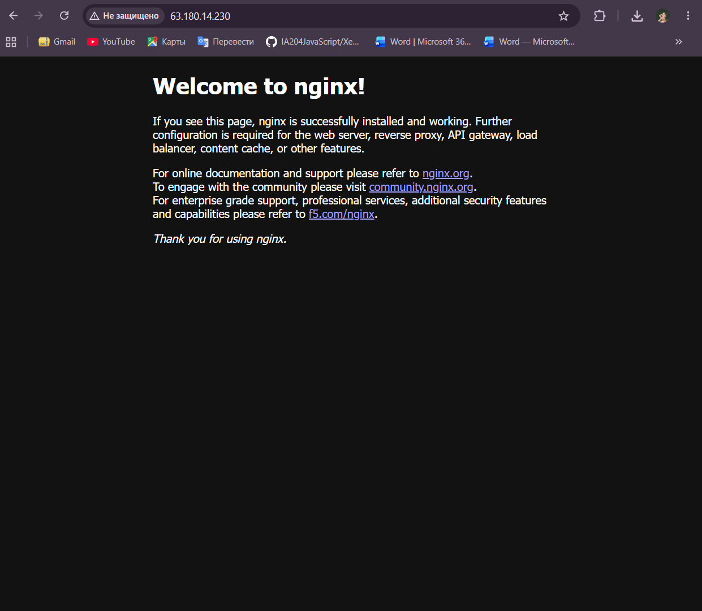

*Рисунок 11 — Nginx отвечает на HTTP-запросы.*

### 3.3. CloudWatch Monitoring

На вкладке **Monitoring** изучены графики Amazon CloudWatch. Среди доступных показателей — загрузка CPU, сетевой трафик и показатели состояния экземпляра. Мониторинг позволяет выявлять аномалии и оценивать нагрузку.

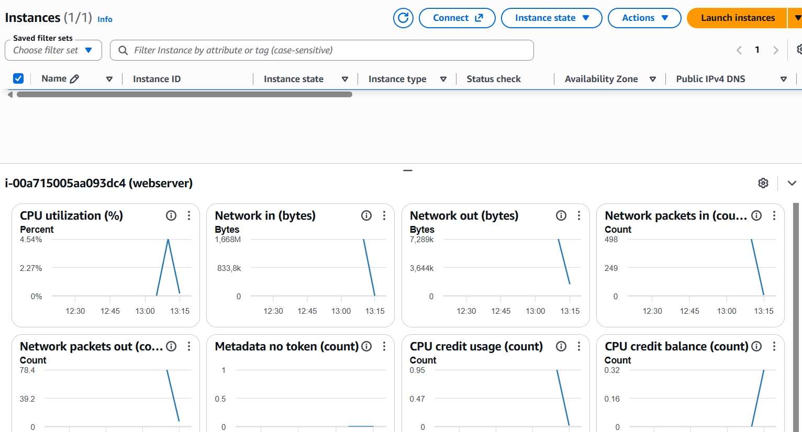

*Рисунок 12 — Метрики экземпляра в Amazon CloudWatch.*

### 3.4. System log и Instance screenshot

В разделе диагностики изучен системный журнал. В нём отображается ход запуска Amazon Linux и работа `cloud-init`, в том числе установка пакетов. Также получен снимок консоли виртуальной машины (**Instance screenshot**), показывающий загрузку ОС.

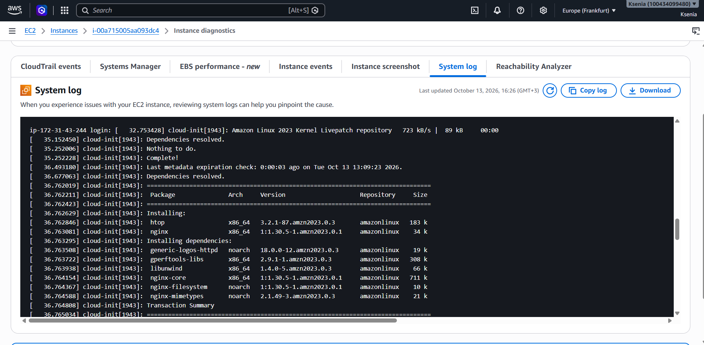

*Рисунок 13 — Системный журнал запуска EC2.*

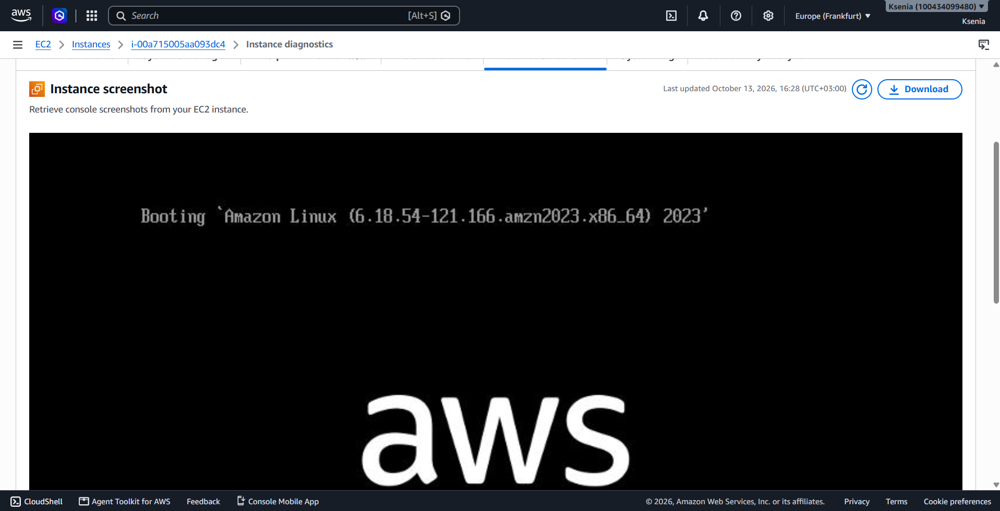

*Рисунок 14 — Экран загрузки Amazon Linux.*

## 4. Удалённое администрирование по SSH

Для подключения использовался Windows PowerShell и ключ `.pem`. Команда подключения:

```powershell
ssh -i "$HOME\.ssh\Ksenia-key.pem" ec2-user@63.180.14.230
```

На одном из этапов подключение по SSH не выполнялось из-за изменения внешнего IP компьютера. После обновления правила SSH в Security Group была проверена доступность порта 22:

```powershell
Test-NetConnection 63.180.14.230 -Port 22
```

**Результат:** `TcpTestSucceeded : True`.

После установления соединения для проверки веб-сервера используется команда:

```bash
sudo systemctl status nginx
```

Наличие состояния **`active (running)`** означает, что служба запущена. На приложенном снимке показана диагностика Nginx в терминале.

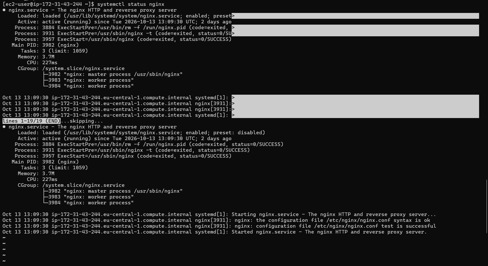

*Рисунок 15 — Проверка службы Nginx через терминал.*

## 5. Размещение веб-сайта

Для демонстрации работы Nginx предусмотрен небольшой сайт из трёх связанных HTML-страниц. Файлы могут передаваться на экземпляр с помощью **SCP** (копирование поверх защищённого SSH-соединения), после чего размещаются в каталоге `/usr/share/nginx/html/`.

Пример передачи файлов с компьютера Windows:

```powershell
scp -i "$HOME\.ssh\Ksenia-key.pem" .\*.html ec2-user@63.180.14.230:~/
```

Пример размещения файлов на сервере:

```bash
sudo cp ~/*.html /usr/share/nginx/html/
```

> Эти команды приведены как способ выполнения задания. Отдельного скриншота передачи файлов через SCP в доступных материалах нет, поэтому сам факт использования именно этих команд не утверждается.

На представленном снимке открыта пользовательская веб-страница, обслуживаемая Nginx. Это подтверждает замену стандартной стартовой страницы собственным содержимым.

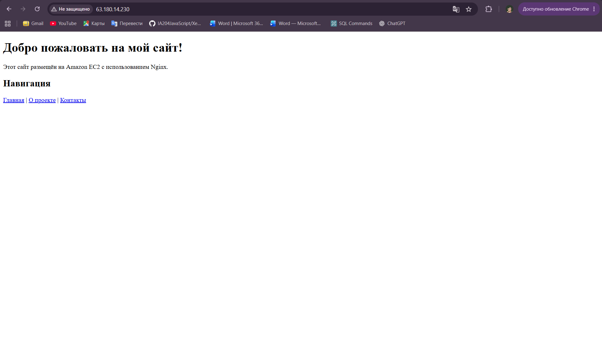

*Рисунок 16 — Пользовательская страница веб-сайта.*

**Ограничение доказательств:** скриншот подтверждает открытие страницы, но не позволяет отдельно проверить наличие и взаимные ссылки всех трёх HTML-файлов. Для полной проверки задания рекомендуется открыть каждую страницу по её URL.

## 6. Остановка экземпляра с помощью AWS CLI

После завершения работы выполнена остановка EC2 через AWS CLI. Для этого применяется команда:

```bash
aws ec2 stop-instances \
  --instance-ids i-00a715005aa093dc4 \
  --region eu-central-1
```

CLI возвращает сведения об изменении состояния экземпляра (например, переход от `running` к `stopping`). Затем в AWS Console проверяется конечное состояние **`Stopped`**.

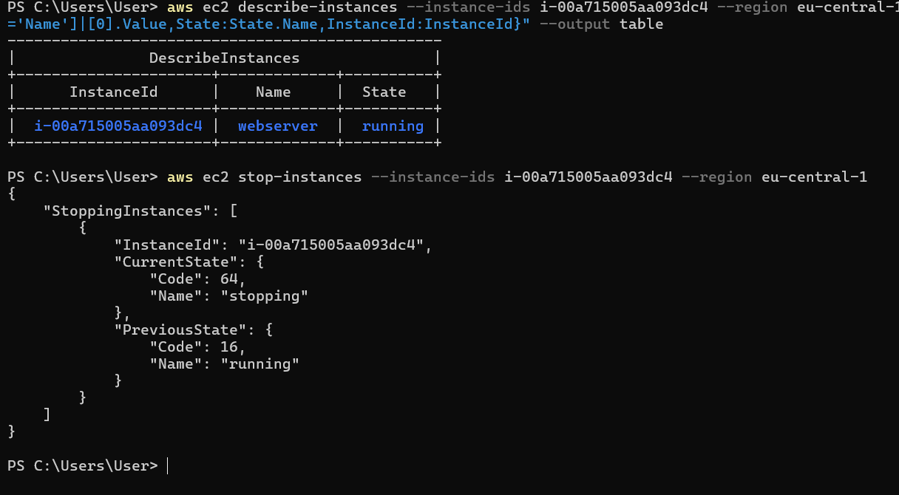

*Рисунок 17 — Выполнение команды остановки через AWS CLI.*

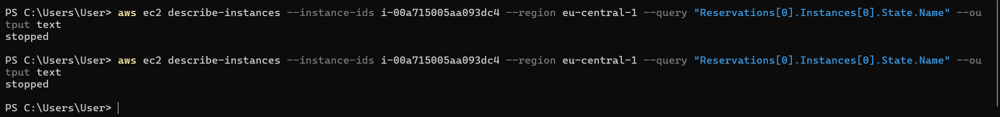

*Рисунок 18 — Подтверждение остановки EC2.*

**Важно:** остановка прекращает начисление платы за вычислительные ресурсы экземпляра, но том EBS и некоторые другие ресурсы могут продолжать тарифицироваться. Остановка не равнозначна удалению (`Terminate`).

## 8. Ответы на контрольные вопросы

**1. Для чего нужны IAM-пользователи и группы?**  
IAM позволяет управлять идентификацией и разрешениями в AWS. Группы упрощают назначение одинаковых политик нескольким пользователям. `AdministratorAccess` предоставляет очень широкие права на ресурсы аккаунта, поэтому в реальной среде предпочтителен принцип минимально необходимых привилегий.

**2. Почему не рекомендуется постоянно работать из-под root-пользователя AWS?**  
Root обладает максимальными полномочиями и используется для отдельных задач управления аккаунтом. Для повседневной работы безопаснее использовать отдельные IAM-идентификаторы или роли с необходимыми разрешениями и MFA.

**3. Что такое AMI и тип экземпляра?**  
AMI — шаблон виртуальной машины с операционной системой и конфигурацией загрузки. Тип экземпляра задаёт вычислительные характеристики: процессор, память, сетевые возможности и другие ресурсы.

**4. Для чего нужны Security Groups?**  
Это виртуальные межсетевые экраны уровня экземпляра, управляющие разрешённым входящим и исходящим трафиком. В работе порт 22 ограничен адресом администратора, а порт 80 открыт для HTTP.

**5. Что такое User Data?**  
User Data — передаваемый экземпляру сценарий начальной настройки. В данной работе он обновляет пакеты, устанавливает `htop` и `nginx`, запускает Nginx и включает автозапуск службы.

**6. Чем отличаются проверки System, Instance и EBS?**  
System проверяет инфраструктуру AWS; Instance — доступность гостевой системы; EBS — состояние подключённого блочного хранилища. Успешные проверки не гарантируют исправность самого веб-приложения, поэтому отдельно выполняется HTTP-проверка.

**7. Для чего нужен CloudWatch?**  
CloudWatch собирает метрики и позволяет создавать сигналы тревоги. Базовый мониторинг EC2 обычно имеет интервал 5 минут, подробный — 1 минуту и может приводить к дополнительным расходам.

**8. Почему для SSH используют ключи, а не обычный пароль?**  
Ключи обеспечивают криптографическую аутентификацию без передачи пароля. Закрытый ключ должен оставаться только у владельца и храниться в защищённом месте.

**9. Что такое SCP?**  
SCP — способ безопасной передачи файлов между локальной системой и удалённым сервером через SSH. Он подходит для загрузки HTML-файлов на EC2.

**10. В чём разница между Stop и Terminate?**  
`Stop` останавливает виртуальную машину, позволяя впоследствии снова запустить её; данные на сохраняемых EBS-томах остаются. `Terminate` завершает существование экземпляра, а удаление томов зависит от параметра `Delete on termination`.

**11. Почему после остановки EC2 может измениться публичный IPv4?**  
Автоматически назначенный публичный IPv4 обычно освобождается при остановке и назначается заново при следующем запуске. Для постоянного адреса можно использовать Elastic IP, учитывая возможную тарификацию публичных IPv4.

**12. Почему важно контролировать расходы даже при использовании Free Tier?**  
Условия бесплатного использования зависят от аккаунта, региона, ресурса и действующей программы AWS. Дополнительные тома, публичные IPv4, платные функции и превышение лимитов могут приводить к начислениям. AWS Budgets помогает уведомлять о расходах, но сам по себе не выключает ресурсы.

## 9. Итоги и вывод

В ходе лабораторной работы выполнены основные операции по развёртыванию и администрированию облачного веб-сервера в Amazon EC2. Создан экземпляр Amazon Linux 2023 типа `t3.micro`, настроены ключ SSH, Security Group и том EBS. Через User Data автоматизирована установка Nginx и `htop`. Проверены статус экземпляра, работа HTTP, диагностический журнал и метрики CloudWatch. Получены результаты проверки службы Nginx и работы пользовательской веб-страницы. Экземпляр остановлен через AWS CLI, а его состояние проверено в консоли.

Практическая работа показала взаимосвязь вычислительных ресурсов EC2, сетевых правил, системы аутентификации, мониторинга и управления жизненным циклом виртуальной машины. Дополнительно закреплены навыки документирования результата в Markdown и размещения материалов на GitHub.

---